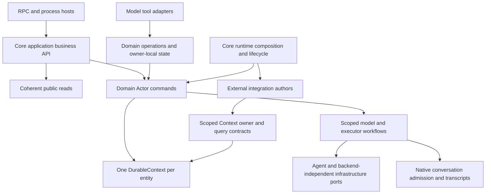
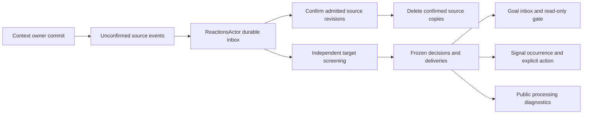

# Core architecture review and design interview

Status: analysis and target organization complete; eight design choices confirmed. Baseline: `b7ff77b`. This review covers every core source, test, fixture and package file, plus its integration, infrastructure and API consumers. Production implementation is not authorized by this design interview.

## Resolved decisions

1. **One application business API — accepted.** Core owns application-facing operations, Actor routing, domain validation and public query projections. The API package owns RPC adaptation, wire validation and encoding. Applications do not receive runtime Actor selectors or internal business snapshots. Integration-authoring and infrastructure capabilities retain explicit supported entry points. Actor-local tools continue to use their owning state service where routing through the owner's mailbox would deadlock.
2. **One business state authority per entity — accepted.** Goal, Task, Signal, Approval, Reaction and Memory persist state, receipts, delivery records and execution checkpoints in their owning DurableContext. AgentConversations owns Agent sessions and input/output evidence, with explicit native admission handoffs retained. Remove Signal's separate event-reconstruction authority, TaskExecution's independent business checkpoint journal and mirrored committed state Refs. A Task owner state service must serialize short business/checkpoint mutations shared with execution workers; the mailbox still owns scheduling. Never hold that writer across a model invocation or external executor call. External sending/unknown markers must commit before/after the transport boundary.
3. **Manual, reversible Goal archival — accepted.** A Goal is a continuing responsibility and has active/archived status. Remove End and completed/ended Goal semantics. Only the user archives or unarchives a Goal; Agents cannot do so. Archival stops new automatic evaluation and owner Signal triggers, retains history, accepted inputs and Task feedback, and leaves accepted Tasks under their own execution owners. Cancelling a Task requires an explicit independent operation. Unarchival resumes the responsibility. Never claim that archival cancels external work.
4. **Two distinct Context relevance boundaries — accepted.** System One performs low-cost independent relevance routing for each eligible Goal/Signal. A Goal's separate read-only Agent gate determines whether routed Context evidence enters its durable main conversation. User input, direct Goal messages and Task feedback bypass that gate. Preserve independent failures, retry/recovery and gate/main scheduling; consolidate implementations only within each responsibility.
5. **Scoped transient queries, persistent Actor owners — accepted.** Remove the centralized ContextsActor discovery/query mailbox. Scoped Context query capabilities own execution limits, caller cancellation, native retained evidence and paging. Memory search/expand use a scoped recall capability; MemoryActor owns only durable capture admission, retry and source observation. Each Context's business query command still belongs to its Actor, and invocation is retired with the owner route scope. Model tools and application callers share the same query execution boundary; no unbounded detached work or duplicate capacity policy is introduced.
6. **Goal messages are distinct from Tasks — accepted.** A Task is concrete work executed by an internal Agent or an external executor with its own persistent lifecycle. Remove Task.Goal and the mixed task/message dispatch contract. Cross-Goal communication is an independently named durable Goal-message operation/tool. A Signal's explicit action either sends a Goal message or creates a Task; neither source evidence nor an occurrence grants execution authority. Goal messages retain source identity and exact-retry semantics without manufacturing Task Actors or references.
7. **Source evidence retained until durable Reaction admission — accepted.** Reaction commits the incoming evidence, or coalesces only unfrozen queued changes according to its existing policy, before acknowledging source revisions. DurableContext then removes confirmed source event copies. Frozen, failed, unknown and operator-retry work retain their evidence in Reaction state. Source acknowledgment loss is safely replayable; persistence failure before admission cannot delete source evidence. Implement one explicit Reaction handoff rather than a speculative general multi-consumer framework.
8. **No schedule catch-up after Goal archival — accepted.** On user unarchival, owner cron Signals calculate their next time from the restoration instant; already-expired once Signals become exhausted without creating an occurrence. Occurrences admitted before archival remain retained. Goal archival suppresses eligibility rather than permanently changing an independently paused Signal's status. Restoration cannot reactivate a manually paused/deleted rule.

## Observed boundaries and open decisions

- The API server currently knows `/user/goals`, `/user/tasks`, `/user/approvals` and `/user/system-one`, constructs private commands, reads private snapshots and defines active-entity listing policy. Core query handlers and tools contain additional projections and routing. Accepted direction: move application business operations into core and reuse domain projections.
- Goal and Task business snapshots use DurableContext, while Signal state is reconstructed from `signal.event` entries in AgentConversations and copied into Context state. TaskExecution also persists a separate `task.execution` checkpoint. Business state authority and mandatory native conversation handoffs need a deliberate separation.
- Goal lifecycle terminology conflicts: the current protocol implements End and persists `completed`. The user rejected End and confirmed reversible manual archival with independent Task ownership.
- GoalStore and TaskStore maintain a second committed Ref beside the canonical DurableContext record. Remove duplicated authority if typed owner reads can supply the same contract without compromising serialized mutations or uncertainty fencing.

## Retained invariants

Accepted domain inputs persist before acknowledgment. Exact retries reuse durable receipts; conflicting request identities fail. Local interruption does not prove external cancellation; unknown submission outcomes are reconciled without automatic resubmission. Native conversation admission is a separate durable boundary and requires explicit handoff/recovery. Mailboxes own scheduling; domain state services own authorized mutations. Goal-local tools share GoalState's writer. Generation checks reject retired worker results. Public reads exclude native frames, private receipts, credentials and executor handles. Core imports no concrete integrations or infrastructure. Runtime owns core assembly, integration activation, readiness and shutdown.

## Review deliverables

This review includes severity-ordered findings, the eight confirmed design boundaries, explicit public entry points, complete baseline/target inventories and every baseline file disposition. Technical organization and validation below are the concrete refactor proposal; production implementation requires a separate instruction.

The accepted [Agent tools and Context retrieval design](tools-design.md) subsequently refines model-facing Task inputs, automatic feedback ownership, Context directory/path hints, typed invocation uncertainty and grouped tool files. It supersedes the tool-specific target rows and dispositions below that merge adapters into `goals/tools.ts`, `tasks/tools.ts` and `memory/tools.ts`. This review's inventories and counts remain the recorded review snapshot; the later document lists the refined files and responsibilities.

## Findings from source and consumer traces

1. **P1: Goal termination contradicts the confirmed domain lifecycle.** `goals/state/admission.ts:145` persists `completed`; `goals/actor.ts:39-58` cancels unstarted work and pauses owned Signals on End. This loses the continuing, reversible responsibility required by manual archival. Replace the command and persisted semantics; accepted Task ownership must survive archival.
2. **P2: Business responses can mix different revisions and state.** `packages/api/src/server.ts:162-183` reads owner state through an asynchronous mailbox query and obtains the revision separately from DurableContext. `tasks/view.ts:36-44` captures a record before a separate owner query. A concurrent commit can produce a response whose revision does not belong to its state, affecting subsequent CAS recovery. Public projections need one coherent committed owner snapshot, with transcript evidence selected by its retained references.
3. **P2: Application behavior leaks through private runtime details.** `packages/api/src/server.ts:41-65` selects Actors and builds commands; lines 125-211 define active-entity filtering and business list projections. `src/index.ts` publicly exposes roots, raw snapshots and private query helpers. Move this behavior to the accepted application API and keep transport and owner implementation contracts separate.
4. **P2: Business state has inconsistent authority and recovery paths.** `signals/state/store.ts:111-161` rebuilds a Pi event history before projecting DurableContext; `tasks/execution/checkpoint.ts:27-54` appends complete execution checkpoints to another journal. GoalStore and TaskStore mirror canonical state in additional Refs. Consolidate business state, receipts and delivery/checkpoint records without removing native conversation handoff reconciliation.
5. **P2: Execution policy, durable transitions and provider operations are interleaved.** `tasks/execution/service.ts` combines confirmation, prepared policy, internal conversation steering, provider submission, approval transport, outcome selection, reconciliation and cancellation. Its writer covers external calls through `deliver`. A unified Task state writer must instead persist begin/settle transitions briefly and release before model/provider work; do not move this entire execution function under the domain writer.
6. **P2: Tool schemas duplicate and weaken domain contracts.** `tools/task/schema.ts:10-12` declares the internal Agent reply target as any string, while `tasks/contracts.ts:25` requires GoalPath. Signal schedule/action schemas are also rewritten independently. Define domain inputs once with Effect Schema and derive SDK tool schemas at the agent boundary; tools adapt operations rather than reimplement validation/routing.
7. **P2: Target preparation can silently turn unavailable/corrupt state into ineligibility.** `reactions/policy.ts:52-67` skips missing Goal records and converts Goal/Signal state-read failures into Option.none. A configured owner still initializing, or an invalid retained snapshot, can therefore disappear from a source's frozen target set. Empty-target work is then completed permanently. Target preparation must distinguish authoritative ineligibility from pending initialization and decoding failure; retain affected evidence/target identity and make the failure/defer state visible without blocking unrelated targets or waiting for every child to restore.
8. **P2: Executor instructions describe a publication path that does not exist.** `tasks/execution/external.ts:19` says a Signal's explicit action publishes results after separate approval, but the current Signal action union has no publishing operation. The confirmed actions are Goal messages and concrete Tasks. Remove that invented pipeline from prepared instructions while preserving delegation confirmation, action-specific approval and exact destination/content constraints.
9. **P2: Content-only Intent identity rejects genuinely new source events.** `goals/screening/decision.ts:95-101` excludes revision from the content fingerprint; `goals/screening/intent.ts:26-30` uses it for intentId; `goals/state/admission.ts:55-67` rejects an already-known intent identity under a new delivery request. A source changing A -> B -> A has distinct durable source events but the same A intentId. An isolated synthetic fake-decision check confirms different event IDs with identical intent IDs for revisions 1 and 3. Derive Intent/delivery identity once from the source event and target; keep payload equality/fingerprints only where needed to validate exact command retries, not historical content dedupe.
10. **P3: Query and presentation duties have several pathways.** ContextQueries offers direct invocation, while ContextsActor adds a second scheduling/reply/cancellation path for Agent evidence. MemoryActor similarly combines durable capture with transient recall. Goal/Task root queries, API handlers and model tools also derive overlapping projections. The accepted direction is scoped queries with durable owner scheduling retained.
11. **P3: Catalogues and type-only imports inflate runtime dependencies.** The emitted JavaScript includes `import {}` from type-only inline imports, including tasks/delivery -> tasks/root; the combined Goal/Task catalogue connects execution back to coordination tools. Emitted modules contain an eight-module Task/tool cycle. Use explicit import type and compose separate owner-specific catalogues without introducing a generic tool registry.
12. **P3: Some retained records have no business reader.** ApprovalEvent messages are appended beside authoritative decision entries; no production consumer reads that separate event stream. Remove unused audit duplication, but retain revocation/response identities required to reject late delivery and replay. Durable Context source events require explicit consumer admission acknowledgment before pruning; they are not equivalent to unused audit records.

## Working layer direction

Keep domain modules rather than introducing a generic workflow/entity framework. Each owner keeps a private command protocol, schema-backed state and explicit transitions; only application contracts, integration-authoring contracts and infrastructure ports are supported public surfaces. Root Actors retain concrete registration/routing/supervision responsibilities. Runtime owns activation and lifecycle; business readiness remains inside each owning Actor. A short domain state writer and a provider operation's lifetime/order are different concerns.

The existing `SystemOneActor` in reactions/actor.ts already owns durable source admission, frozen screening and delivery records. Rename it ReactionsActor to describe its business role and retain it as the processing UI data source. The user's forwarding question was clarified as asking whether this Actor already exists; it does not request a new relay Actor or a universal message bus.

## Supported entry points and dependency direction

| Entry                      | Supported caller and surface                                                                                                                                                                                                                        |
| -------------------------- | --------------------------------------------------------------------------------------------------------------------------------------------------------------------------------------------------------------------------------------------------- |
| `@aster/core`              | Local/other hosts: AsterRuntime and AsterApplication. Runtime owns internal assembly and installation; hosts choose backend/source Layers.                                                                                                          |
| `@aster/core/contracts`    | Browser/RPC consumers: public response/input schemas, stable identities and ApplicationError. No Actor refs, private snapshots or native provider handles.                                                                                          |
| `@aster/core/integrations` | Integration authors: ContextActor/ContextCommand, CurrentContextPath/path helpers, DurableContext owner contracts, scoped query contracts, installation, capture policy and shared language/settings/error contracts actually used by integrations. |
| `@aster/core/ports`        | Infra adapters: ContextPersistence/makeDurableContext/storage schemas, SystemOneClient, external executor capabilities, MemoryBackend and captured process environment.                                                                             |
| `@aster/core/testing`      | Tests: real isolated DurableContext ownership/seeding and injected persistence. Domain tests import private implementations relatively rather than widening production exports.                                                                     |

Keep the core package together. These entry points establish supported audiences; they do not introduce a new package per domain, a manager hierarchy or an externally supplied service for every helper. Integration owners are trusted code using explicit schemas; generic application/transport reads still expose only ContextText or selected business DTOs.

Internal dependency direction is public schemas/ports -> canonical ownership and domain transitions -> scoped model/executor workflows -> mailbox scheduling -> runtime/application assembly. Domain tools adapt existing operations, not raw Actors. Private cross-Actor command construction stays inside the owning domain operations and one runtime addressing boundary. Explicit import type removes emitted empty imports; separate Goal and Task catalogues prevent evidence execution from importing an entire coordination catalogue.

## Application API shape

AsterRuntime.layer installs AsterApplication. Applications provide no second business assembly graph. AsterRuntime retains only host lifecycle/readiness capabilities; native selectors and private snapshots are not returned. API handlers consume AsterApplication, perform RPC encoding/tracing and map its scoped public subscriptions to transport invalidation keys.

| Application group     | Operations and contract                                                                                                                                                                                |
| --------------------- | ------------------------------------------------------------------------------------------------------------------------------------------------------------------------------------------------------ |
| Contexts              | List/get/watch committed text, describe active capabilities, invoke supported read-only commands. Static configured metadata, persisted text and live capability availability remain distinguishable.  |
| Goals                 | List/get committed public state, page public conversation, submit user input, archive/unarchive and retry a known failed input. Source-qualified Goal messages use a separate internal operation/tool. |
| Tasks                 | List/inspect concrete work, start/send/check/retry/cancel with stable operation identities. Acceptance is a durable receipt; it does not imply completion or confirmed cancellation.                   |
| Signals               | List/read/change rules with explicit actions and observed definition versions. Derived owner eligibility is separate from manual rule status.                                                          |
| Approvals             | List public decision entries and respond to the identified decision. Exact repeated answers reuse their committed receipt; conflicting answers fail.                                                   |
| Processing            | Inspect bounded source/target/decision/delivery records and explicitly retry failed screening or unknown delivery. ReactionsActor is the existing durable owner and UI source.                         |
| Runtime/subscriptions | Sanitized health/readiness inspection and scoped Context/health invalidations. Overflow fails with a reconnect/refresh requirement rather than silently dropping updates.                              |

Mutating operations carry a stable identity supplied by their caller, or the existing unique decision identity where it already defines the operation. Return the owner's durable receipt instead of discarding it or creating an unknown server-side identity. Expected failures stay typed; acknowledgment timeout reports unknown acceptance and requires reuse of the original identity. Do not add a general receipt database or transaction coordinator.

Business list/read responses come from one detached committed owner revision, including archived or temporarily unavailable owners when selected by the query. Lifecycle/status filters are explicit parameters, not a side effect of Actor lookup. Runtime availability is separate from business existence. Native history views select evidence by that snapshot's references and declared transcript boundaries; unrelated later private entries cannot change the response's claimed business revision. Generic Context query errors retain the owner's declared codec.

## State and execution ownership

| Owner    | DurableContext authority                                                                                                                                                               | Separate native/temporary ownership                                                                                                                                      |
| -------- | -------------------------------------------------------------------------------------------------------------------------------------------------------------------------------------- | ------------------------------------------------------------------------------------------------------------------------------------------------------------------------ |
| Goal     | Definition, active/archived lifecycle, summary, accepted input references/receipts, gate/main handoffs and Task links.                                                                 | AgentConversations owns input/reply bodies and native submission/transcript receipts. Gate/main slots and generation tokens are temporary mailbox state.                 |
| Task     | Admission, accepted inputs/receipts, round/coverage, prepared policy, confirmation, original session/checkpoint and sending/unknown markers, outcome references and delivery handoffs. | Native input/result evidence and Harness submissions remain in AgentConversations. Active invocation handles and provider-operation ordering are scoped execution state. |
| Signal   | Rule/status/version/cursor, accepted changes/reactions, immutable occurrences, exact action/evidence and pending/started delivery records.                                             | Timer Fibers, activation/retry slots and in-flight delivery tokens remain mailbox-owned. No Pi signal-event reconstruction authority.                                    |
| Approval | Identified request/decision, validated answer, revocation proof and acknowledged/retryable response delivery.                                                                          | Retried delivery work is scoped. No unused duplicate ApprovalEvent audit history.                                                                                        |
| Reaction | Source inbox/watermarks, unfrozen coalescing, frozen target inputs, independent decisions, exact deliveries/receipts and recovery authorization.                                       | Matching/delivery/cooldown slots are temporary; model HTTP lives behind its port.                                                                                        |
| Memory   | Accepted frozen captures, pending work and completed capture identities.                                                                                                               | Backend owns admitted transport work/drain; scoped recall is independent of capture scheduling.                                                                          |

A state service opens one typed owner handle. It reads the canonical committed value and commits through that handle; it does not keep another committed Ref or append a business snapshot to a second journal. The domain writer covers validation, short native handoff/checkpoint operations and state persistence. Provider/model execution runs outside that writer. Scope closure revokes local operations and drains admitted writes before releasing ownership. Non-persistent invocation slots are not duplicate business authority.

Native body/admission/result append and business reference commit remain two real durable boundaries. Preserve exact identities and reconciliation at that seam rather than claiming atomicity across stores. Internal Check reuses the original native submission; Retry is an explicit new attempt of known failed work. External sending/unknown markers commit around transport calls, and authoritative provider observations settle the same original work. Absence of a handle is never permission to resubmit. Feedback to an archived Goal remains durable and pending rather than ignored.

Root Goal/Task/Signal Actors do not persist empty `{}` Context states solely for catalogue descriptions. They retain registration, routing and supervision duties; capability descriptions are declared metadata. Goal restoration includes retained identities/definitions: removing an entry from configuration cannot implicitly archive/delete a continuing responsibility. Configured definition refresh cannot reset persisted archival state.

## Archival and action rules

- Goal archival is user-only and reversible. New automatic gate/main evaluations and owner Signal triggers do not start while archived. Accepted inputs and feedback remain queued. An evaluation already running can settle its accepted work; no subsequent evaluation starts. New Task/rule operations still validate current owner eligibility at admission.
- Direct user input to an archived Goal requires explicit unarchival. Frozen/internal Goal messages and Task feedback can be durably queued without starting evaluation. Archival does not invent an external-cancellation result or cancel accepted Tasks.
- Owner archival suppresses Signal eligibility, independently of its active/paused/deleted definition status. On unarchival, update cursors before arming: cron chooses its next instant, expired once becomes nextDue=null. Preserve occurrences admitted before archival; reconcile sending deliveries by stable identity, and retain archive-blocked unstarted work for restoration instead of terminally rejecting it.
- Task means internal Agent or external executor work. The separate send_goal_message tool uses the destination Goal's durable input receipt and creates no TaskActor. Signal actions are SendGoalMessage or StartTask, with source/action/evidence frozen per occurrence. A Signal action's acceptance acknowledges its destination owner, not model completion.
- Keep the two relevance boundaries: independent low-cost routing and a separate read-only Goal gate. The primary Goal catalogue coordinates work; fresh integration/Context/Memory evidence retrieval remains in concrete internal Tasks. Both catalogue input schemas derive from domain Effect Schema at the SDK adapter boundary, with runtime decoding for constraints JSON Schema cannot express.

## Source handoff and processing UI

Prune only source revisions whose evidence has committed in Reaction state, including existing permitted coalescing of unfrozen work. Persisted target decisions/failed work keep their own evidence. A crash after Reaction admission but before source pruning replays the original identity and watermarks; it does not re-screen committed decisions. Concurrent new source commits retain events above the confirmed revision. Target preparation must retain unavailable/invalid targets explicitly rather than silently treating them as unmatched.

Source pruning is event-metadata maintenance: it changes neither owner State/Messages nor their business revision, emits no new model source event, and does not require a live source Actor. Extend ContextPersistence with an atomic event-only prune capability; the native adapter updates EventsDoc through its existing session transaction/routing without needing a retired owner's message-key callback or rewriting unrelated snapshot data. The same path writer coordinates commit/prune; only confirmed persistence updates the canonical event index. Interrupted/unknown pruning reconciles through the existing fence/reopen mechanism and can retry the acknowledgment without repeating screening. Pruning means logical deletion of confirmed source records; native JSONL history can still contain older transaction bytes, so physical compaction is a separate storage concern.

Source event identity and target determine one frozen delivery/Intent identity. Exact replay preserves that identity, while A -> B -> A is a new event and can enter a new evaluation. Private/message-only changes that do not emit source events still cause no routing. Do not add historical summary-content fingerprint dedupe behind the event identity.

Keep the existing bounded completed processing window (currently 100) and unfinished work. It is suitable for current processing UI, not a promised unlimited calibration/message archive. Native conversation history, admitted-work receipts, revocation proofs and Memory dedupe identities are not deleted by an arbitrary audit cleanup. No universal forwarding Actor, multi-consumer event registry or parallel log authority is added.

## Consequences outside core

- packages/api: schemas reference core public DTOs; handlers consume AsterApplication and stop importing root command families, selectors, private snapshots and AgentConversations. Preserve transport tracing, cancellation, strict wire codecs and invalidation overflow behavior.
- packages/agent: add the necessary Effect Schema-to-SDK tool adapter and native selected-answer text helper. Verify conversion against installed SDK validators; no manually duplicated domain TypeBox schemas or core business dependencies enter agent.
- packages/infra: use the explicit ports entry; extend native Context storage with event-only confirmed pruning and migrate internal/external Task contract imports. Backend acquisition/drain and the configured root remain unchanged.
- packages/integrations: use the integration-authoring entry and typed explicit Signal action/message contracts where applicable. Integration business readiness and child behavior remain owned there; runtime does not acquire new integration policy.
- apps/local: consume runtime/application lifecycle plus existing independent backend Layers. HTTP only requires AsterApplication for business handlers.
- apps/web: replace End with archive/unarchive controls and explicit status filtering; use coherent public Goal/Task/Signal schemas and receipts. No Actor or persistence imports.
- Maintained core/runtime/Goals/delegation/Context/configuration docs and glossary must adopt these contracts. Historical ADRs remain historical; mark supersession where appropriate. Remove End, Task.Goal, signal.event authority, task.execution checkpoint authority and raw snapshot API names from supported paths when implementation lands, without compatibility facades.

## Implementation order and acceptance checks

1. Introduce selected public DTOs and AsterApplication over the current owners; move existing API behavior into core and prove coherent reads/receipts before removing old exports.
2. Establish canonical short state writers. Move Signal occurrences/receipts and Task execution checkpoint into their own DurableContext; retain native handoff proofs, then delete replay/projection/cached-state authorities.
3. Replace End with archive/unarchive and derived Signal eligibility; prove independent accepted Tasks, retained feedback/input and missed-time disposition.
4. Split Goal messages from concrete Tasks and Signal actions; preserve exact source authorization, frozen payloads and acknowledgment identities.
5. Replace concentrated Context/Memory read mailboxes with scoped query/recall capabilities; retain owner command scopes, bounded capacity, cancellation and native query result replay/paging.
6. Add atomic source acknowledgment/pruning after Reaction admission and explicitly retained unavailable/invalid targets. Rename the existing processing owner ReactionsActor and reuse its public diagnostics.
7. Group tools by owner, derive their SDK schemas once, replace fake/legacy-shaped fixtures and narrow package exports. Update consumers, documentation and UI controls.

Use node:test with real isolated Actors, injected backend/model/HTTP capabilities, Deferred and TestClock. Prove mixed valid/invalid targets, slow owner startup, no-match completion, multiple independent Goals/Signals, archived recipients and failed consumers. Check concurrent read revisions, exact replay/conflict, distinct A -> B -> A source events, commit-before-ack, admitted commit drain, retired callbacks, unknown submission reconciliation, native handoff recovery, source pruning after lost acknowledgment, query result replay after retirement and capacity release on cancellation. Add public-import boundary checks without replacing the existing test runner or adding generic mocks that bypass owner behavior.

For implementation, run pnpm build, focused package tests, pnpm test, pnpm check, diagnostics for affected projects and pnpm test:web because Goal lifecycle controls change. Pin APIs to installed Effect 4.0.0 (vendored reference is 4.0.2). Do not invoke real models, external executors or messaging services, or modify runtime data/credentials for validation.

This design phase modifies only documentation. Inventory completeness and Markdown formatting are checked, and one isolated synthetic fake-decision check confirms the Intent identity collision; the production test suites are not re-run for documentation-only work. The proposed inventory has 102 source files, 59 tests/fixtures and 5 package/build/document files, totaling 166. Every one of the 158 baseline files has a disposition. Implementation begins only after the user explicitly requests it.

## Complete baseline file inventory

The baseline contains 102 source files, 51 tests/fixtures and 5 package/document/build files (158 total). Tests are inventoried by observable responsibilities; existing assertions about live-only queries, End and Pi-only Signal/checkpoint authority must be replaced when the confirmed design changes those contracts.

| Baseline file                            | Responsibility                                                                                                           |
| ---------------------------------------- | ------------------------------------------------------------------------------------------------------------------------ |
| `README.md`                              | Package capabilities, ownership, composition, supported behavior and validation guidance.                                |
| `package.json`                           | Package exports, dependencies and local build/typecheck/test entry points.                                               |
| `src/approvals/actor.ts`                 | Decision queue mailbox, immediate/retried answer delivery, revoke and acknowledgment routing.                            |
| `src/approvals/contracts.ts`             | Native input/permission request and response schemas plus privacy-filtered public entries.                               |
| `src/approvals/queries.ts`               | Actor-owned decision entry query protocol.                                                                               |
| `src/approvals/snapshot.ts`              | Private decision/revocation state and append-only approval event schemas.                                                |
| `src/approvals/state.ts`                 | Durable decision validation, idempotent resolve, enqueue/revoke/acknowledge and public serialization.                    |
| `src/config/context-directory.ts`        | Explicit configured source path/description metadata used by Goal prompts.                                               |
| `src/config/language.ts`                 | Typed output-language settings, Chinese default and shared prompt instruction.                                           |
| `src/context/actor.ts`                   | Context Actor definition wrapper: owner identity, virtual child addressing, scoped query catalogues and pending replies. |
| `src/context/contracts.ts`               | Public serialized Context text and dynamic query input/error schemas.                                                    |
| `src/context/errors.ts`                  | Typed owner validation, conflict, retirement, commit and recovery failures.                                              |
| `src/context/handle.ts`                  | Typed owner API for current state, immutable ordered messages, atomic mutations and watches.                             |
| `src/context/location.ts`                | Current Context path dependency injected into the owning Behavior.                                                       |
| `src/context/model.ts`                   | Stored snapshots, source events, directory metadata and recovery invariants.                                             |
| `src/context/queries/actor.ts`           | Read-only discovery and bounded Agent query execution through a dedicated mailbox.                                       |
| `src/context/queries/protocol.ts`        | Discoverable command classes with argument, result, error and text contracts.                                            |
| `src/context/queries/results.ts`         | Conversation-owned retained query evidence, stable replay identity and paged text reads.                                 |
| `src/context/queries/routes.ts`          | Scoped dynamic query registration, invocation, discovery, result validation and text/JSON encoding.                      |
| `src/context/store.ts`                   | Canonical committed index, owner leases, per-path writers, persistence fencing, reads and publication.                   |
| `src/contracts.ts`                       | Browser-safe schema exports; excludes runtime and persistence implementations.                                           |
| `src/goals/actor.ts`                     | Goal mailbox scheduling, read-only screening slot, conversation slot, generation guards and current End coordination.    |
| `src/goals/agent.ts`                     | Goal conversation policy/tools, native Harness execution, second relevance gate and response logging.                    |
| `src/goals/contracts.ts`                 | Goal identity/definition and evidence, user, Task and feedback input schemas.                                            |
| `src/goals/protocol.ts`                  | Transient Goal commands, replies, input envelopes, receipt fingerprint and internal worker results.                      |
| `src/goals/queries.ts`                   | Live child discovery, business details, raw snapshot asks and committed-state coordination reads.                        |
| `src/goals/receipt.ts`                   | Durable request identity, canonical payload fingerprint and accepted command receipt.                                    |
| `src/goals/root.ts`                      | Configured Goal child registration, supervision observation, command routing and root query execution.                   |
| `src/goals/screening/decision.ts`        | One-target System One relevance scoring, normalization, rationale, identity and structured diagnostics.                  |
| `src/goals/screening/intent.ts`          | Frozen Goal evidence/delivery envelopes and stable source-content identity.                                              |
| `src/goals/settings.ts`                  | Configured responsibilities, built-in personal Goal and model/context budget settings.                                   |
| `src/goals/state/admission.ts`           | Request deduplication, input/source validation, current End mutation and explicit failed-input retry.                    |
| `src/goals/state/inputs.ts`              | Pi input append/reference handoff, body resolution and interrupted acceptance recovery.                                  |
| `src/goals/state/model.ts`               | Actor-local serialized Goal mutations shared by mailbox handlers and local model tools.                                  |
| `src/goals/state/snapshot.ts`            | Private Goal business snapshot, ordered input references and state invariants.                                           |
| `src/goals/state/store.ts`               | DurableContext persistence plus a mirrored committed Ref and reader-visible state serialization.                         |
| `src/goals/view.ts`                      | Public conversation paging, Goal business projection and latest failed-input recovery affordance.                        |
| `src/index.ts`                           | Current broad public barrel: runtime, domain Actors, protocols, state schemas and helpers.                               |
| `src/json.ts`                            | Pure JSON normalization removing undefined object properties before schema validation.                                   |
| `src/memory/actor.ts`                    | Durable capture admission/retry, capture identity retention, source subscription and bounded recall dispatch.            |
| `src/memory/capture.ts`                  | Registered source-specific capture policies with cheap identities and lazy evidence reads.                               |
| `src/memory/contracts.ts`                | Backend-independent capture/recall contracts, metadata and typed failures.                                               |
| `src/operations.ts`                      | Application errors, command identities, Context revisions and acknowledgment receipts.                                   |
| `src/process/environment.ts`             | Redacted captured launch environment contract shared with native adapters.                                               |
| `src/reactions/actor.ts`                 | Durable source ingestion, bounded planning/delivery slots, cooldowns, generation checks and operator recovery.           |
| `src/reactions/contracts.ts`             | Explicit screening/delivery recovery authorization and durable receipt schemas.                                          |
| `src/reactions/inspection.ts`            | Privacy-filtered processing diagnostics derived from frozen target/delivery state.                                       |
| `src/reactions/model.ts`                 | Inbox coalescing, target freezing, planning/delivery transitions, retention and recovery validation.                     |
| `src/reactions/policy.ts`                | Eligible target reads, independent Signal/Goal model matching and exact receiver delivery.                               |
| `src/reactions/queries.ts`               | Raw processing-state Actor query command.                                                                                |
| `src/reactions/settings.ts`              | Typed matching and delivery concurrency limits.                                                                          |
| `src/reactions/state.ts`                 | Queued/frozen source work, candidates, decisions, delivery receipts and recovery invariants.                             |
| `src/runtime/errors.ts`                  | Typed runtime configuration and integration registration failures.                                                       |
| `src/runtime/integration.ts`             | Per-runtime installation, captured module dependencies, activation phase and stop contract.                              |
| `src/runtime/runtime.ts`                 | Internal Layer assembly, source activation, root startup, readiness, health/events and ordered shutdown.                 |
| `src/services/actors.ts`                 | Injected current Actor addressing and generic asynchronous query reply/cancellation helpers.                             |
| `src/services/agent-input.ts`            | Selected native assistant answer text extraction without transcript reconstruction.                                      |
| `src/services/domain-reads.ts`           | Dynamic Actor lookup and schema-decoded domain snapshot query adaptation.                                                |
| `src/services/system-one.ts`             | Decision transport port, choice/score question contracts and domain output-language composition.                         |
| `src/signals/actor.ts`                   | Signal activation, versioned timers, occurrence dispatch, retry scheduling and delivery completion.                      |
| `src/signals/contracts.ts`               | Signal definitions, Context conditions and validated once/cron schedules.                                                |
| `src/signals/protocol.ts`                | Rule changes, frozen reactions, owner pause, receipts and scheduling/delivery mailbox messages.                          |
| `src/signals/queries.ts`                 | Live child Signal listing and read-only public rule projections.                                                         |
| `src/signals/root.ts`                    | Configured/restored Signal registration, dynamic creation, queries and owner pause fan-out.                              |
| `src/signals/settings.ts`                | Typed configured Signal definitions loaded from the captured provider.                                                   |
| `src/signals/state/model.ts`             | Rule ownership/version changes, eligibility, timing, occurrence admission and delivery transitions.                      |
| `src/signals/state/snapshot.ts`          | Public rule snapshot, status/version/cursor invariants and owner eligibility.                                            |
| `src/signals/state/store.ts`             | Authoritative Pi event replay, Context rule projection, receipts and frozen delivery history.                            |
| `src/tasks/actor.ts`                     | Task admission mailbox, execution scheduling, results, approval signaling, cancellation and generation checks.           |
| `src/tasks/contracts.ts`                 | Current mixed Goal-message/internal/external Task union, prepared evidence and admission/follow-up/recovery schemas.     |
| `src/tasks/delivery.ts`                  | Cross-Actor Task admission, Goal attachment, direct Goal messages, feedback retry and receipt reconciliation.            |
| `src/tasks/execution/agent.ts`           | Internal Task Harness conversation options, evidence instruction rendering and tool identities.                          |
| `src/tasks/execution/checkpoint.ts`      | Independent Pi execution checkpoint journal, restored session/delivery markers and mirrored Ref.                         |
| `src/tasks/execution/contracts.ts`       | External executor capability, session/status schemas and uncertain-outcome errors.                                       |
| `src/tasks/execution/external.ts`        | Default reviewed executor policy and self-contained prepared Task text rendering.                                        |
| `src/tasks/execution/service.ts`         | Combined internal/external execution, frozen policy, confirmation, delivery, steering, reconciliation and cancellation.  |
| `src/tasks/protocol.ts`                  | Task commands, admission replies, cancellation and worker completion messages.                                           |
| `src/tasks/queries.ts`                   | Live Task child queries, raw snapshot asks and committed state recovery reads.                                           |
| `src/tasks/root.ts`                      | Persistent Task child restoration, lazy first admission, routing and supervision observation.                            |
| `src/tasks/state/admission.ts`           | Stable Task path, source authorization and frozen Signal occurrence validation.                                          |
| `src/tasks/state/model.ts`               | Mailbox-owned Task business admission, input/result handoff recovery, start, settle and cancellation.                    |
| `src/tasks/state/snapshot.ts`            | Private Task lifecycle, accepted input references, work rounds, pending requests and outcomes.                           |
| `src/tasks/state/store.ts`               | Lazy first-state persistence, typed reads and mirrored committed Task Ref.                                               |
| `src/tasks/view.ts`                      | Task detail projection, selected transcript/tool evidence, approval status and Memory capture policy.                    |
| `src/testing/context.ts`                 | In-memory/fault-injected persistence, owner seeding, mirrored inspection and fake Actor query fixtures.                  |
| `src/tools/actors.ts`                    | Tool-side dynamic Actor asks, acknowledgment uncertainty and query cancellation bridge.                                  |
| `src/tools/catalogues.ts`                | Goal coordination and Task evidence-retrieval tool composition.                                                          |
| `src/tools/context/describe-context.ts`  | Agent adapter for one Context capability/argument catalogue.                                                             |
| `src/tools/context/list-contexts.ts`     | Agent adapter for paged active Context capability discovery.                                                             |
| `src/tools/context/query-context.ts`     | Agent adapter for supported read-only queries with retained evidence identity.                                           |
| `src/tools/context/read-query-result.ts` | Agent adapter for reading subsequent pages without repeating the source query.                                           |
| `src/tools/context/result.ts`            | Retained query page decoding and readable Agent output formatting.                                                       |
| `src/tools/define.ts`                    | Effect tool descriptors, public result formatting and read/write error exposure policy.                                  |
| `src/tools/goal/goal-current.ts`         | Local GoalState read adapter exposing public business state and available executors.                                     |
| `src/tools/goal/update-summary.ts`       | Local GoalState mutation adapter for durable business summary changes.                                                   |
| `src/tools/memory/memory-expand.ts`      | Agent adapter for expanding selected backend recall identities.                                                          |
| `src/tools/memory/memory-search.ts`      | Agent adapter for compact backend recall search.                                                                         |
| `src/tools/signal/schema.ts`             | Handwritten SDK-schema copy of Signal action/timing definitions.                                                         |
| `src/tools/signal/set-signal.ts`         | Goal-owned Signal mutation tool, stable operation identity and owner namespace mapping.                                  |
| `src/tools/signal/signal-list.ts`        | Goal-owned Signal list tool through the Signal root.                                                                     |
| `src/tools/task/schema.ts`               | Handwritten SDK-schema copy of the mixed Task union.                                                                     |
| `src/tools/task/start-task.ts`           | Model coordination adapter for Task creation or direct Goal-message delivery.                                            |
| `src/tools/task/task-list.ts`            | Local GoalState adapter for owned/replying Task summaries.                                                               |
| `src/tools/task/task-send.ts`            | Stable-identity adapter for an existing Task follow-up.                                                                  |
| `test/actor-queries.test.ts`             | Live domain query contracts, root child isolation and child-read cancellation.                                           |
| `test/actor.test.ts`                     | Context owner restoration, Actor restart/stop and virtual/public child addressing.                                       |
| `test/approvals.test.ts`                 | Decision validation, persistence-before-delivery, recreation and acknowledgment.                                         |
| `test/context-command.test.ts`           | Discoverable command codecs, scoped ownership, cancellation, defects and shared reply correlation.                       |
| `test/context-commit.test.ts`            | Writer serialization, CAS, admitted-commit drain, uncertainty fencing and recovery publication.                          |
| `test/context-discovery.test.ts`         | Capability-only discovery, strict arguments and route release/cancellation.                                              |
| `test/context-queries.test.ts`           | Retained Agent query pages, replay after retirement and changed-identity rejection.                                      |
| `test/context-reactions.test.ts`         | Independent multi-target selection, evidence privacy, bounded matching and malformed decision failures.                  |
| `test/context-session.test.ts`           | Immutable append order/deletion, state/message watches, leases, layouts and detached recovery reads.                     |
| `test/context-views.test.ts`             | Serialized-state privacy, dormant reads, formatter refresh and serializer defects.                                       |
| `test/context.test.ts`                   | Path encoding, schema boundaries, committed notifications and adapter mutation isolation.                                |
| `test/conversation-fixtures.ts`          | Scoped native Pi memory conversation fixture.                                                                            |
| `test/delegation-admission.test.ts`      | Read-only Task inspection excludes private provider metadata and performs no execution.                                  |
| `test/durable-context.test.ts`           | Recovery rejects missing/regressed/invalid snapshots and validates before persistence.                                   |
| `test/execution-state.test.ts`           | Task admission invariants and fail-closed restored business state.                                                       |
| `test/fixtures.ts`                       | Injected external executor capability defaults.                                                                          |
| `test/goal-command-fixtures.ts`          | Test-only Goal root command and user input helpers.                                                                      |
| `test/goal-context-directory.test.ts`    | Explicit source descriptions, both configuration child layouts and invalid metadata rejection.                           |
| `test/goal-conversation.test.ts`         | Goal gate/main scheduling, admission, native recovery, Tasks/tools, feedback and current End behavior.                   |
| `test/goal-durable-compaction.test.ts`   | Native conversation compaction completes the same stable Goal request.                                                   |
| `test/goal-durable-session.test.ts`      | Native Goal restart retains policy/history and current invocation tools.                                                 |
| `test/goal-fixtures.ts`                  | Explicit Goal reply sink and input-reference inspection.                                                                 |
| `test/goal-intents.test.ts`              | Frozen source intent admission remains valid after intervening Goal revisions.                                           |
| `test/goal-screening.test.ts`            | Event/target intent identity, A -> B -> A, score rules/thresholds, language and failure handling.                        |
| `test/goal-services.test.ts`             | Serialized GoalState mutations, retirement/drain, task attachment and Pi reply handoff.                                  |
| `test/goal-signals.test.ts`              | Rule receipts, owner isolation, versioned timers and exact scheduled delivery.                                           |
| `test/goal-startup.test.ts`              | Slow/failed Goal recovery preserves independent child ownership and sibling progress.                                    |
| `test/goal-title.test.ts`                | Definition/title validation and startup refresh without losing accepted work.                                            |
| `test/goal-working-state.test.ts`        | Pi-owned conversation bodies and derived public error state.                                                             |
| `test/harness-fixtures.ts`               | Fake native Harness invocation/callback boundary preserving Effect context.                                              |
| `test/memory.test.ts`                    | Durable capture admission/dedupe/retry, observer shutdown, defects, privacy and lazy evidence.                           |
| `test/module-settings.test.ts`           | Reasoning budget and reaction concurrency defaults with strict supplied-value validation.                                |
| `test/output-language.test.ts`           | Chinese default, explicit output locale and invalid configuration failure.                                               |
| `test/reaction-events.test.ts`           | Atomic frozen source event persistence, no-event updates and corrupt recovery rejection.                                 |
| `test/review-regressions.test.ts`        | Commit acknowledgment, stopped roots, correction of invalid decisions and corrupt Signal state.                          |
| `test/runtime-lifecycle.test.ts`         | Readiness, activation defects, complete shutdown, pending readiness and owner health failure.                            |
| `test/settings-fixtures.ts`              | Shared language/source metadata/reaction settings Layers for tests.                                                      |
| `test/signal-reaction.test.ts`           | Frozen Signal action/evidence receipts across restart and trigger-type validation.                                       |
| `test/signal-startup.test.ts`            | Slow/failed Signal restoration and delivery recovery with independent owner mailboxes.                                   |
| `test/signal-state.test.ts`              | Definition/cursor/version ownership, frozen deliveries, deletion, budget, Pi projection recovery and drain.              |
| `test/system-one-durable.test.ts`        | Frozen routing, coalescing, durable receipts, replay/recovery, bounded concurrent delivery and retention.                |
| `test/task-durable-session.test.ts`      | Internal steering coverage, native-to-business result handoff and Check/Retry request identity.                          |
| `test/task-fixtures.ts`                  | Real Task/Goal owners with injected executors and business/execution checkpoint seeding.                                 |
| `test/task-followups.test.ts`            | Concurrent follow-ups, reactivation, late outcomes, native handoffs and earlier decision retention.                      |
| `test/task-lifecycle.test.ts`            | Frozen execution policy, confirmation, stable admission and Signal-to-Task delivery.                                     |
| `test/task-recovery.test.ts`             | Authoritative original-work reconciliation and explicit retry of rejected instructions.                                  |
| `test/task-startup.test.ts`              | Task root recreation retains existing child ownership.                                                                   |
| `test/task-state.test.ts`                | Durable commit drain, failed-write isolation and precise completion coverage.                                            |
| `test/tool-fixtures.ts`                  | Real query/Memory/Goal roots with injected backends and model execution disabled.                                        |
| `test/tool-queries.test.ts`              | Recall/query concurrency, caller cancellation, backend failures and mailbox responsiveness.                              |
| `test/workflow-fixtures.ts`              | Legacy-shaped Goal reasoning scenarios over fake models/Harness and current owner tools.                                 |
| `tsconfig.build.json`                    | Declaration and runtime JavaScript build configuration.                                                                  |
| `tsconfig.json`                          | Source/test typechecking and Effect diagnostics configuration.                                                           |
| `tsconfig.test.json`                     | Isolated source/test compilation and node:test discovery configuration.                                                  |

## Complete target file organization

This inventory is the proposed final organization implementing the eight confirmed design choices. Internal files return private Effect capabilities rather than requiring a new public Layer for every helper. File count is not the simplification metric: duplicated authority, query/command gateways, handwritten schemas and unsupported lifecycle concepts disappear.

| Target file                               | Responsibility                                                                                                                                                                                                  |
| ----------------------------------------- | --------------------------------------------------------------------------------------------------------------------------------------------------------------------------------------------------------------- |
| `README.md`                               | Supported public entries, ownership, application/integration/backend composition and local validation guidance.                                                                                                 |
| `package.json`                            | Explicit supported package exports and node:test discovery for nested test ownership groups.                                                                                                                    |
| `src/application/contexts.ts`             | Public text list/read/watch and dynamic query adaptation over the single scoped query execution boundary.                                                                                                       |
| `src/application/contracts.ts`            | Common application errors, mutation identities/receipts and public change envelopes; no transport types.                                                                                                        |
| `src/application/service.ts`              | AsterApplication construction: capture runtime-owned capabilities and compose typed domain operations and scoped subscriptions. Owns bounded scoped Context/health subscriptions and explicit overflow failure. |
| `src/approvals/actor.ts`                  | Mailbox-owned decision admission and immediate/retried response delivery to its original requesting owner.                                                                                                      |
| `src/approvals/contracts.ts`              | Decision requests/responses and explicit public decision views; native metadata stays private.                                                                                                                  |
| `src/approvals/operations.ts`             | Application decision response and internal enqueue/revoke/acknowledge boundaries with stable identities. Includes the coherent privacy-filtered committed decision projection.                                  |
| `src/approvals/protocol.ts`               | Private enqueue/resolve/revoke/acknowledge and delivery commands with typed durable acceptance.                                                                                                                 |
| `src/approvals/state.ts`                  | Durable response validation/idempotence, decision/revocation records and acknowledgment; no redundant approval audit stream.                                                                                    |
| `src/config/context-directory.ts`         | Explicit configured source paths/descriptions for model routing, separate from live capability readiness.                                                                                                       |
| `src/config/language.ts`                  | Typed output-language settings, Chinese default and language instruction.                                                                                                                                       |
| `src/config/reasoning.ts`                 | Shared resolved reasoning model/context budget settings consumed by Goal and internal Task workflows; preserve existing config keys/defaults.                                                                   |
| `src/context/actor.ts`                    | ContextActor definition wrapper: bind owner identity and delegate scoped command-catalogue registration; no business workflow/persistence policy.                                                               |
| `src/context/address.ts`                  | Public/virtual child path derivation, encoded Actor names and explicit owner spawn metadata.                                                                                                                    |
| `src/context/contracts.ts`                | Serialized Context text, dynamic query input/error and capability/result page response schemas.                                                                                                                 |
| `src/context/errors.ts`                   | Typed conflicts, validation, retirement, commit and recovery failures.                                                                                                                                          |
| `src/context/handle.ts`                   | Typed owner contract and handle construction: decoding, immutable message operations, atomic mutations, revocation and watch projections over the same store writer.                                            |
| `src/context/location.ts`                 | CurrentContextPath service bound to the owning Behavior and local commands.                                                                                                                                     |
| `src/context/model.ts`                    | Canonical stored snapshot/source event schemas and recovery identity/order invariants.                                                                                                                          |
| `src/context/queries/commands.ts`         | ContextCommand declarations deriving discoverable payload/success/error/text contracts from the Actor command class.                                                                                            |
| `src/context/queries/evidence.ts`         | Native conversation-owned full query evidence, stable replay identity and paged selected text reads.                                                                                                            |
| `src/context/queries/registration.ts`     | Behavior-scoped query route enrollment, local request correlation and retirement handling for owning Actors.                                                                                                    |
| `src/context/queries/service.ts`          | Scoped ContextQueries catalogue and single validated invocation/capacity/cancellation boundary; text/JSON presentation and retained evidence share execution.                                                   |
| `src/context/storage.ts`                  | Infrastructure persistence/partition contracts and storage routing options; no concrete backend.                                                                                                                |
| `src/context/store.ts`                    | DurableContext authority: canonical records, per-path writers/leases, commit fencing/recovery, coherent watches and explicit post-Reaction-admission source pruning.                                            |
| `src/contracts.ts`                        | Browser-safe public application/domain schemas and errors, with explicit exports only.                                                                                                                          |
| `src/goals/actor.ts`                      | Mailbox-owned gate/main conversation slots, priority scheduling, archival eligibility and generation guards.                                                                                                    |
| `src/goals/contracts.ts`                  | Goal definitions, public active/archived responses, user commands and source-qualified Goal message/evidence contracts.                                                                                         |
| `src/goals/conversation.ts`               | Goal Harness invocation and resolved input rendering with owner-local state/tools; no authoritative business checkpoint copy.                                                                                   |
| `src/goals/operations.ts`                 | Typed application/internal Goal commands and direct durable Goal-message delivery with exact-retry receipts and source validation.                                                                              |
| `src/goals/prompt.ts`                     | Goal conversation policy and language/source-directory composition, independently editable from execution orchestration.                                                                                        |
| `src/goals/protocol.ts`                   | Private mailbox commands/replies and generation-tagged gate/conversation results; archive/unarchive replace End.                                                                                                |
| `src/goals/read.ts`                       | Coherent committed Goal summaries and selected native conversation paging; reused by API, Context commands and local tools. Also declares discoverable read-only Context commands over these same projections.  |
| `src/goals/root.ts`                       | Restore configured and retained Goal identities, route commands and watch independent child recovery; no empty durable root state.                                                                              |
| `src/goals/screening.ts`                  | Read-only second relevance gate using the Goal model; rejected evidence stays outside its durable main conversation.                                                                                            |
| `src/goals/settings.ts`                   | Goal definitions and built-in personal responsibility; omission from config cannot implicitly archive/delete retained Goals.                                                                                    |
| `src/goals/state/admission.ts`            | Exact request dedupe, active/archived admission rules, provenance validation and explicit failed-input retry.                                                                                                   |
| `src/goals/state/history.ts`              | Native input/reply bodies, selected reference resolution and Pi-to-business admission/settlement handoff recovery.                                                                                              |
| `src/goals/state/schema.ts`               | Private Goal state/input/reference/receipt schemas and invariants; no completed/ended lifecycle.                                                                                                                |
| `src/goals/state/service.ts`              | One scoped GoalState writer, typed canonical reads, summary/task/input/lifecycle transitions and retirement.                                                                                                    |
| `src/goals/tools.ts`                      | Goal coordination catalogue: local Goal reads/summary writes, Task operations, Signal operations and separate send_goal_message.                                                                                |
| `src/index.ts`                            | Explicit application/host entry: AsterRuntime and AsterApplication; no domain Actors or private state schemas.                                                                                                  |
| `src/integrations.ts`                     | Supported integration-authoring entry: Context ownership/query contracts, integration installation and capture policy declaration.                                                                              |
| `src/memory/actor.ts`                     | MemoryActor owns durable capture inbox, admitted dispatch slots, retry and backend-drain handoff.                                                                                                               |
| `src/memory/capture.ts`                   | Source-specific identity selection, lazy evidence capture policy registration and scoped observation.                                                                                                           |
| `src/memory/contracts.ts`                 | Public compact/expanded recall and capture policy schemas, separate from adapter connection settings.                                                                                                           |
| `src/memory/protocol.ts`                  | Private capture admission/completion/retry mailbox commands; no transient recall replies.                                                                                                                       |
| `src/memory/recall.ts`                    | Scoped backend search/selected expansion with shared bounded capacity and direct caller cancellation.                                                                                                           |
| `src/memory/state.ts`                     | Canonical capture pending/completed identities and atomic acceptance/completion transitions.                                                                                                                    |
| `src/memory/tools.ts`                     | Model-facing compact search/selected expansion adapters over recall, without a Memory self-ask bridge.                                                                                                          |
| `src/ports.ts`                            | Supported infrastructure entry: Context persistence, decision transport, external executors, Memory backend and captured process environment.                                                                   |
| `src/ports/decisions.ts`                  | SystemOneClient Effect port, prepared choice/score questions and language composition; no HTTP or provider acquisition.                                                                                         |
| `src/ports/executors.ts`                  | External executor Effect capabilities, opaque session identity/status and explicit unknown/rejected failures; no internal-Agent emulation.                                                                      |
| `src/ports/memory.ts`                     | Backend capture/recall metadata and typed failures; adapter-specific connections/process settings remain in infra.                                                                                              |
| `src/ports/process-environment.ts`        | Redacted captured launch environment supplied to native adapters/integrations, with no live environment reads.                                                                                                  |
| `src/reactions/actor.ts`                  | ReactionsActor owns source admission, bounded planning/delivery slots, cooldowns and source acknowledgment after commit.                                                                                        |
| `src/reactions/contracts.ts`              | Public processing/recovery input/result schemas; no raw frozen model evidence in default diagnostics.                                                                                                           |
| `src/reactions/delivery.ts`               | Exact typed receiver commands/receipts and missing-acknowledgment classification; no external execution resubmission.                                                                                           |
| `src/reactions/matching-goals.ts`         | Low-cost System One Goal score policy, threshold/rationale and stable frozen intent construction.                                                                                                               |
| `src/reactions/matching.ts`               | Bounded orchestration of independent Goal/Signal decisions without transport or receiver delivery. Includes the small Signal-condition decision without a separate forwarding module.                           |
| `src/reactions/protocol.ts`               | Private source ingestion/acknowledgment, planning/delivery/recovery and generation-tagged worker-result commands.                                                                                               |
| `src/reactions/read.ts`                   | Coherent public source/target/decision/delivery diagnostics used by processing UI and application API.                                                                                                          |
| `src/reactions/settings.ts`               | Typed matching and receiver-delivery concurrency, preserving existing configuration behavior.                                                                                                                   |
| `src/reactions/state.ts`                  | Single durable inbox/coalescing/frozen work/target/delivery/recovery state and bounded completed diagnostic retention.                                                                                          |
| `src/reactions/targets.ts`                | Freeze eligible active Goal/Context Signal targets from typed committed state, independent of live startup.                                                                                                     |
| `src/runtime/addressing.ts`               | Private typed Actor selection/ask boundary with acknowledgment uncertainty and caller cancellation; no generic domain query gateway.                                                                            |
| `src/runtime/diagnostics.ts`              | Runtime health and bounded sanitized owner/event diagnostics; emit health invalidations without business-state mutation.                                                                                        |
| `src/runtime/errors.ts`                   | Typed configuration and integration acquisition/registration errors.                                                                                                                                            |
| `src/runtime/integration.ts`              | Typed integration installation/captured dependencies, source/consumer activation contract and duplicate-name validation.                                                                                        |
| `src/runtime/lifecycle.ts`                | Ordered startup/activation and comprehensive shutdown; domain readiness stays in its owner, all cleanup phases run.                                                                                             |
| `src/runtime/runtime.ts`                  | Acquire core capabilities/owners, install AsterApplication and expose host readiness/lifecycle without Actor selectors.                                                                                         |
| `src/shared/json.ts`                      | Pure validated JSON normalization used at persistence/public projection boundaries.                                                                                                                             |
| `src/shared/paths.ts`                     | Browser-safe canonical Context/Goal/Task/Signal path schemas, eliminating repeated regexes and cross-domain contract import cycles.                                                                             |
| `src/signals/actor.ts`                    | Mailbox timers, per-rule activation/delivery slots, retries and no archive-period schedule catch-up.                                                                                                            |
| `src/signals/contracts.ts`                | Explicit Goal-message or concrete Task action, rule ownership/status/version and validated once/cron schedules.                                                                                                 |
| `src/signals/operations.ts`               | Typed rule create/update/pause/resume/delete and list operations shared by application and Goal tools.                                                                                                          |
| `src/signals/protocol.ts`                 | Private change/reaction/tick/delivery and owner-eligibility notifications; no permanent pause fan-out on Goal archival.                                                                                         |
| `src/signals/read.ts`                     | Coherent public Signal definition/cursor/eligibility projection, separate from private occurrence/delivery records. Also declares discoverable read-only Context commands over these same projections.          |
| `src/signals/root.ts`                     | Configured/retained rule registration and owner-status notifications with independent child recovery; no empty root persistence.                                                                                |
| `src/signals/settings.ts`                 | Typed configured Signal rules/actions resolved once from captured configuration.                                                                                                                                |
| `src/signals/state/schema.ts`             | Single private rule/receipt/occurrence/outbox state and transition invariants; no Pi event-replay authority.                                                                                                    |
| `src/signals/state/service.ts`            | Mailbox-owned rule/occurrence/delivery commits through DurableContext, preserving exact frozen actions and receipts.                                                                                            |
| `src/signals/timing.ts`                   | Pure validated next-time/cursor policy, DST handling and missed-time disposition on Goal unarchival.                                                                                                            |
| `src/tasks/actor.ts`                      | Mailbox admission/scheduling, generation-safe outcomes, approval/feedback dispatch and independently authorized cancellation.                                                                                   |
| `src/tasks/capture.ts`                    | Lazy Memory capture of selected Task/frozen source evidence, independent of UI projection.                                                                                                                      |
| `src/tasks/contracts.ts`                  | Concrete internal/external Task requests, public status/details and follow-up/recovery/cancellation schemas; no Task.Goal.                                                                                      |
| `src/tasks/execution/external.ts`         | External original-session submission, status/answer/steer/retry/cancellation operations with unknown-outcome discipline. Owns original-session Check/Retry reconciliation.                                      |
| `src/tasks/execution/internal.ts`         | Native Harness admission/reconciliation, active steering coverage and internal cancellation for the original request. Owns native Check/Retry reconciliation.                                                   |
| `src/tasks/execution/preparation.ts`      | Freeze reviewed executor policy/language/evidence and format self-contained Task text exactly once.                                                                                                             |
| `src/tasks/execution/workflow.ts`         | Run/send/cancel coordination over TaskState begin/settle operations; model/provider calls occur outside its state writer.                                                                                       |
| `src/tasks/feedback.ts`                   | Stable Task outcome-to-Goal feedback identity and acknowledged delivery retry; archive does not discard feedback.                                                                                               |
| `src/tasks/identity.ts`                   | Stable Task path/request identities derived from the admitted source and operation identity.                                                                                                                    |
| `src/tasks/operations.ts`                 | Concrete Task start/send/check/retry/cancel application/internal operations and receipt reconciliation; no Goal-message dispatch.                                                                               |
| `src/tasks/protocol.ts`                   | Private Task admission, work, answer/cancellation and generation-tagged worker-result commands.                                                                                                                 |
| `src/tasks/read.ts`                       | Coherent committed Task response plus selected transcript/tool evidence and decision status; no private provider metadata. Also declares discoverable read-only Context commands over these same projections.   |
| `src/tasks/root.ts`                       | Restore/admit/register persistent Task owners, route commands and observe child termination; no durable empty root record.                                                                                      |
| `src/tasks/state/admission.ts`            | Source/occurrence authorization, concrete Task identity, input/approval validation and durable admission receipts.                                                                                              |
| `src/tasks/state/history.ts`              | Native admission/input/result evidence references and interrupted handoff recovery without another execution.                                                                                                   |
| `src/tasks/state/schema.ts`               | One private business snapshot including rounds, input references, execution checkpoints, frozen policy and durable delivery markers.                                                                            |
| `src/tasks/state/service.ts`              | Single scoped TaskState writer shared by short mailbox/execution transitions; canonical read/commit and retirement.                                                                                             |
| `src/tasks/tools.ts`                      | Internal Task evidence catalogue composed from Context and Memory tool adapters; excludes Goal coordination tools.                                                                                              |
| `src/testing/context.ts`                  | Real DurableContext over isolated memory/fault-injected persistence and typed seeding/inspection through supported owners.                                                                                      |
| `src/tools/define.ts`                     | Thin Effect model-tool adapter/formatting/error policy using SDK schema conversion at the agent boundary; no handwritten domain schemas.                                                                        |
| `test/application/api.test.ts`            | Application method schemas, stable mutation receipts, public projections and unsupported/private surface exclusion.                                                                                             |
| `test/application/regressions.test.ts`    | Commit acknowledgment, stopped roots, correction of invalid decisions and corrupt Signal state.                                                                                                                 |
| `test/application/subscriptions.test.ts`  | Subscribe-before-refresh, coherent public invalidation identity, overflow failure and scoped release.                                                                                                           |
| `test/approvals/decisions.test.ts`        | Decision validation, persistence-before-delivery, recreation and acknowledgment.                                                                                                                                |
| `test/config/language.test.ts`            | Chinese default, explicit output locale and invalid configuration failure.                                                                                                                                      |
| `test/config/settings.test.ts`            | Reasoning budget and reaction concurrency defaults with strict supplied-value validation.                                                                                                                       |
| `test/context/actor.test.ts`              | Context owner restoration, Actor restart/stop and virtual/public child addressing.                                                                                                                              |
| `test/context/commands.test.ts`           | Discoverable command codecs, scoped ownership, cancellation, defects and shared reply correlation.                                                                                                              |
| `test/context/commit.test.ts`             | Writer serialization, CAS, admitted-commit drain, uncertainty fencing and recovery publication.                                                                                                                 |
| `test/context/discovery.test.ts`          | Capability-only discovery, strict arguments and route release/cancellation.                                                                                                                                     |
| `test/context/domain-queries.test.ts`     | Coherent domain projections and Context command adapters, including dormant/failed owner reads without mixed revisions.                                                                                         |
| `test/context/evidence.test.ts`           | Retained Agent query pages, replay after retirement and changed-identity rejection.                                                                                                                             |
| `test/context/owner.test.ts`              | Immutable append order/deletion, state/message watches, leases, layouts and detached recovery reads.                                                                                                            |
| `test/context/query-cancellation.test.ts` | Shared scoped query capacity, backend cancellation and isolated stable evidence identities without a concentrated mailbox.                                                                                      |
| `test/context/recovery.test.ts`           | Recovery rejects missing/regressed/invalid snapshots and validates before persistence.                                                                                                                          |
| `test/context/source-handoff.test.ts`     | Reaction admission before source pruning, lost acknowledgment replay, concurrent commits and failure fencing.                                                                                                   |
| `test/context/store.test.ts`              | Path encoding, schema boundaries, committed notifications and adapter mutation isolation.                                                                                                                       |
| `test/context/text.test.ts`               | Serialized-state privacy, dormant reads, formatter refresh and serializer defects.                                                                                                                              |
| `test/fixtures/conversations.ts`          | Scoped native Pi memory conversation fixture.                                                                                                                                                                   |
| `test/fixtures/executors.ts`              | Injected external executor capability defaults.                                                                                                                                                                 |
| `test/fixtures/goal-commands.ts`          | Test-only Goal root command and user input helpers.                                                                                                                                                             |
| `test/fixtures/goal.ts`                   | Explicit Goal reply sink and input-reference inspection.                                                                                                                                                        |
| `test/fixtures/harness.ts`                | Fake native Harness invocation/callback boundary preserving Effect context.                                                                                                                                     |
| `test/fixtures/models.ts`                 | Current native conversation/gate model fixtures with Effect capabilities; removes the old progress/completed reasoning shape.                                                                                   |
| `test/fixtures/queries.ts`                | Real query/Memory/Goal roots with injected backends and model execution disabled.                                                                                                                               |
| `test/fixtures/settings.ts`               | Shared language/source metadata/reaction settings Layers for tests.                                                                                                                                             |
| `test/fixtures/task.ts`                   | Real Task/Goal owners with injected executors and business/execution checkpoint seeding.                                                                                                                        |
| `test/goals/archival.test.ts`             | User-only archive/unarchive, queued inputs/feedback, settled in-flight work and independent accepted Tasks.                                                                                                     |
| `test/goals/context-directory.test.ts`    | Explicit source descriptions, both configuration child layouts and invalid metadata rejection.                                                                                                                  |
| `test/goals/conversation.test.ts`         | Goal gate/main scheduling, admission, native recovery, Tasks/tools, feedback and archival and independent Task behavior.                                                                                        |
| `test/goals/durable-compaction.test.ts`   | Native conversation compaction completes the same stable Goal request.                                                                                                                                          |
| `test/goals/durable-session.test.ts`      | Native Goal restart retains policy/history and current invocation tools.                                                                                                                                        |
| `test/goals/intents.test.ts`              | Frozen source intent admission remains valid after intervening Goal revisions.                                                                                                                                  |
| `test/goals/messages.test.ts`             | Separate cross-Goal message admission/source identity, replay/conflict and absence of a manufactured Task.                                                                                                      |
| `test/goals/screening.test.ts`            | Event/target intent identity, A -> B -> A, score rules/thresholds, language and failure handling.                                                                                                               |
| `test/goals/services.test.ts`             | Serialized canonical Goal mutations, retirement/drain, task attachment and native handoff recovery; no mirrored Ref.                                                                                            |
| `test/goals/signals.test.ts`              | Rule receipts, owner isolation, versioned timers and exact scheduled delivery.                                                                                                                                  |
| `test/goals/startup.test.ts`              | Slow/failed Goal recovery preserves independent child ownership and sibling progress.                                                                                                                           |
| `test/goals/title.test.ts`                | Definition/title validation and startup refresh without losing accepted work.                                                                                                                                   |
| `test/goals/working-state.test.ts`        | Pi-owned conversation bodies and derived public error state.                                                                                                                                                    |
| `test/memory/capture.test.ts`             | Durable capture admission/dedupe/retry, observer shutdown, defects, privacy and lazy evidence.                                                                                                                  |
| `test/memory/recall.test.ts`              | Scoped typed compact/expanded recall, bounded capacity and cancellation independent of durable capture.                                                                                                         |
| `test/reactions/durability.test.ts`       | Frozen routing, coalescing, durable receipts, replay/recovery, bounded concurrent delivery and retention.                                                                                                       |
| `test/reactions/events.test.ts`           | Atomic frozen source event persistence, no-event updates and corrupt recovery rejection.                                                                                                                        |
| `test/reactions/matching.test.ts`         | Independent multi-target selection, evidence privacy, bounded matching and malformed decision failures.                                                                                                         |
| `test/runtime/exports.test.ts`            | Public host/contracts/integration/port entries remain separate and imports do not expose private snapshots or instantiate owners.                                                                               |
| `test/runtime/lifecycle.test.ts`          | Readiness, activation defects, complete shutdown, pending readiness and owner health failure.                                                                                                                   |
| `test/signals/archival.test.ts`           | Owner archival suppresses eligibility without changing manual pause/deletion; missed cron/once times do not catch up.                                                                                           |
| `test/signals/reaction.test.ts`           | Frozen Signal action/evidence receipts across restart and trigger-type validation.                                                                                                                              |
| `test/signals/startup.test.ts`            | Slow/failed Signal restoration and delivery recovery with independent owner mailboxes.                                                                                                                          |
| `test/signals/state.test.ts`              | Canonical rule/occurrence/receipt commits, immutable actions, exact retry, deletion, schedule/DST/cursor policy and interrupted persistence.                                                                    |
| `test/tasks/durable-session.test.ts`      | Internal steering coverage, native-to-business result handoff and Check/Retry request identity.                                                                                                                 |
| `test/tasks/execution-state.test.ts`      | Task admission invariants and fail-closed restored business state.                                                                                                                                              |
| `test/tasks/followups.test.ts`            | Concurrent follow-ups, reactivation, late outcomes, native handoffs and earlier decision retention.                                                                                                             |
| `test/tasks/inspection.test.ts`           | Read-only Task inspection excludes private provider metadata and performs no execution.                                                                                                                         |
| `test/tasks/lifecycle.test.ts`            | Frozen execution policy, confirmation, stable admission and Signal-to-Task delivery.                                                                                                                            |
| `test/tasks/recovery.test.ts`             | Authoritative original-work reconciliation and explicit retry of rejected instructions.                                                                                                                         |
| `test/tasks/startup.test.ts`              | Task root recreation retains existing child ownership.                                                                                                                                                          |
| `test/tasks/state.test.ts`                | Durable commit drain, failed-write isolation and precise completion coverage.                                                                                                                                   |
| `tsconfig.build.json`                     | Runtime/declaration output without leaking private implementation types through public entries.                                                                                                                 |
| `tsconfig.json`                           | Source/test typechecking and Effect diagnostics against pinned Effect 4.0.0.                                                                                                                                    |
| `tsconfig.test.json`                      | Compile source, nested tests and private fixtures into isolated test output.                                                                                                                                    |

## Disposition of every baseline file

| Baseline file                            | Disposition                                                                                                                                                                  |
| ---------------------------------------- | ---------------------------------------------------------------------------------------------------------------------------------------------------------------------------- |
| `README.md`                              | Retain and update for the supported public surface, grouped tests and final ownership contracts                                                                              |
| `package.json`                           | Retain and update for the supported public surface, grouped tests and final ownership contracts                                                                              |
| `src/approvals/actor.ts`                 | Split protocol and operation boundaries; retain mailbox delivery/retry                                                                                                       |
| `src/approvals/contracts.ts`             | Retain provider/private versus public decision field separation                                                                                                              |
| `src/approvals/queries.ts`               | Delete raw decision entry ask; use approvals/read.ts                                                                                                                         |
| `src/approvals/snapshot.ts`              | Merge private state schema into approvals/state.ts; remove unused ApprovalEvent audit record                                                                                 |
| `src/approvals/state.ts`                 | Retain durable decision rules; extract read/operations and remove duplicate audit messages                                                                                   |
| `src/config/context-directory.ts`        | Retain explicit metadata settings                                                                                                                                            |
| `src/config/language.ts`                 | Retain language settings/instruction                                                                                                                                         |
| `src/context/actor.ts`                   | Split into context/actor.ts, address.ts and queries/registration.ts                                                                                                          |
| `src/context/contracts.ts`               | Retain and add typed query/public response contracts                                                                                                                         |
| `src/context/errors.ts`                  | Retain typed owner failures; refresh obsolete pending-file comment                                                                                                           |
| `src/context/handle.ts`                  | Retain owner contract and append/delete/watch semantics                                                                                                                      |
| `src/context/location.ts`                | Retain injected owner identity                                                                                                                                               |
| `src/context/model.ts`                   | Retain canonical snapshot/source event schemas and source identity; no generic event subsystem                                                                               |
| `src/context/queries/actor.ts`           | Delete concentrated query mailbox; scoped queries/service.ts and evidence.ts replace its actual responsibilities                                                             |
| `src/context/queries/protocol.ts`        | Move to queries/commands.ts; registration owns erased reply correlation                                                                                                      |
| `src/context/queries/results.ts`         | Move to queries/evidence.ts; keep native result identity and pagination                                                                                                      |
| `src/context/queries/routes.ts`          | Consolidate into queries/service.ts with one capacity/cancellation boundary and scoped route registration                                                                    |
| `src/context/store.ts`                   | Split persistence contract to context/storage.ts and typed owner construction to handle.ts; store retains the canonical writer, recovery, watch hydration and source pruning |
| `src/contracts.ts`                       | Retain browser-safe barrel with explicit public response schemas                                                                                                             |
| `src/goals/actor.ts`                     | Retain scheduling; replace End handling with reversible user archival                                                                                                        |
| `src/goals/agent.ts`                     | Split into goals/conversation.ts, prompt.ts and screening.ts                                                                                                                 |
| `src/goals/contracts.ts`                 | Rewrite with active/archived public responses and separate Goal messages                                                                                                     |
| `src/goals/protocol.ts`                  | Retain private protocol; remove raw-snapshot and End/peer termination commands                                                                                               |
| `src/goals/queries.ts`                   | Split into goals/read.ts and operations.ts; delete raw snapshot gateway                                                                                                      |
| `src/goals/receipt.ts`                   | Merge private receipt schema into goals/state/schema.ts                                                                                                                      |
| `src/goals/root.ts`                      | Retain concrete routing/registration; restore retained definitions and remove empty durable root                                                                             |
| `src/goals/screening/decision.ts`        | Move low-cost relevance policy to reactions/matching-goals.ts                                                                                                                |
| `src/goals/screening/intent.ts`          | Move frozen intent building into reactions/matching-goals.ts and envelope schema into private protocol                                                                       |
| `src/goals/settings.ts`                  | Retain definitions; extract shared reasoning to config/reasoning.ts                                                                                                          |
| `src/goals/state/admission.ts`           | Retain and update archive/message admission and exact retries                                                                                                                |
| `src/goals/state/inputs.ts`              | Move to goals/state/history.ts; preserve native handoff recovery                                                                                                             |
| `src/goals/state/model.ts`               | Move to goals/state/service.ts; keep serialized local-tool/mailbox mutations                                                                                                 |
| `src/goals/state/snapshot.ts`            | Move to goals/state/schema.ts; private active/archived state                                                                                                                 |
| `src/goals/state/store.ts`               | Merge into goals/state/service.ts; remove mirrored committed Ref                                                                                                             |
| `src/goals/view.ts`                      | Split into goals/read.ts and public response schemas; no opaque Schema.Json state responses                                                                                  |
| `src/index.ts`                           | Rewrite with explicit host/application exports; add integrations.ts and ports.ts entry points                                                                                |
| `src/json.ts`                            | Move to shared/json.ts                                                                                                                                                       |
| `src/memory/actor.ts`                    | Split durable capture into memory/actor.ts, protocol.ts and state.ts; recall moves to recall.ts                                                                              |
| `src/memory/capture.ts`                  | Retain cheap identity/lazy evidence selection and scoped policy registration                                                                                                 |
| `src/memory/contracts.ts`                | Split adapter port into ports/memory.ts and typed public/policy contract into memory/contracts.ts                                                                            |
| `src/operations.ts`                      | Move to application/contracts.ts                                                                                                                                             |
| `src/process/environment.ts`             | Move to ports/process-environment.ts                                                                                                                                         |
| `src/reactions/actor.ts`                 | Retain owner as ReactionsActor; extract protocol and add post-admission source acknowledgment                                                                                |
| `src/reactions/contracts.ts`             | Retain explicit public processing/recovery schemas                                                                                                                           |
| `src/reactions/inspection.ts`            | Move coherent public projections to reactions/read.ts                                                                                                                        |
| `src/reactions/model.ts`                 | Merge private state mutation implementation into reactions/state.ts                                                                                                          |
| `src/reactions/policy.ts`                | Split into targets.ts, matching.ts, matching-goals.ts and delivery.ts                                                                                                        |
| `src/reactions/queries.ts`               | Delete raw processing snapshot ask; use coherent reactions/read.ts                                                                                                           |
| `src/reactions/settings.ts`              | Retain module-owned concurrency settings                                                                                                                                     |
| `src/reactions/state.ts`                 | Retain private schemas and merge state operations; avoid separate forwarding store                                                                                           |
| `src/runtime/errors.ts`                  | Retain typed acquisition/installation failures                                                                                                                               |
| `src/runtime/integration.ts`             | Retain module installation/activation; expose supported integration entry only                                                                                               |
| `src/runtime/runtime.ts`                 | Split lifecycle and diagnostics; install application service, hide Actor addressing                                                                                          |
| `src/services/actors.ts`                 | Move private addressing into runtime/addressing.ts; delete concentrated query reply/cancellation helpers                                                                     |
| `src/services/agent-input.ts`            | Move native answer extraction to the necessary agent package boundary; do not keep an empty forwarding service                                                               |
| `src/services/domain-reads.ts`           | Delete raw Actor snapshot gateway; domain reads use coherent committed snapshots                                                                                             |
| `src/services/system-one.ts`             | Move to ports/decisions.ts; keep prepared business questions and language composition                                                                                        |
| `src/signals/actor.ts`                   | Retain timers/delivery; derive owner archival eligibility and reset missed-time cursors on restoration                                                                       |
| `src/signals/contracts.ts`               | Replace mixed task field with explicit action; retain validated timing                                                                                                       |
| `src/signals/protocol.ts`                | Retain private protocol; replace PauseByOwner with eligibility notification                                                                                                  |
| `src/signals/queries.ts`                 | Split into signals/read.ts; no live-only listing gate                                                                                                                        |
| `src/signals/root.ts`                    | Retain concrete owners and notify eligibility; remove empty root and permanent pause fan-out                                                                                 |
| `src/signals/settings.ts`                | Retain settings with explicit action schemas                                                                                                                                 |
| `src/signals/state/model.ts`             | Split transitions into signals/state/service.ts and timing.ts                                                                                                                |
| `src/signals/state/snapshot.ts`          | Split public rule schemas into contracts.ts and private occurrences/receipts into state/schema.ts                                                                            |
| `src/signals/state/store.ts`             | Delete event replay/projection store; merge one canonical commit path into state/service.ts                                                                                  |
| `src/tasks/actor.ts`                     | Retain mailbox scheduling; execute through short TaskState transitions and independently scoped workers                                                                      |
| `src/tasks/contracts.ts`                 | Keep concrete Agent/Delegate Task contracts; remove Goal-message branch and add coherent public responses                                                                    |
| `src/tasks/delivery.ts`                  | Split Task operations and feedback into tasks/operations.ts and feedback.ts; Goal-message delivery moves to goals/operations.ts                                              |
| `src/tasks/execution/agent.ts`           | Move native conversation preparation/execution into tasks/execution/internal.ts                                                                                              |
| `src/tasks/execution/checkpoint.ts`      | Delete independent journal/Ref; checkpoint schema and transitions live in tasks/state/schema.ts and service.ts                                                               |
| `src/tasks/execution/contracts.ts`       | Move adapter port to ports/executors.ts; public Task contracts remain in tasks/contracts.ts                                                                                  |
| `src/tasks/execution/external.ts`        | Move reviewed policy/freezing/rendering to execution/preparation.ts; external.ts becomes original-provider workflow                                                          |
| `src/tasks/execution/service.ts`         | Split into execution/workflow.ts, internal.ts and external.ts; durable markers use TaskState                                                                                 |
| `src/tasks/protocol.ts`                  | Retain private protocol; add identified cancellation acceptance and remove raw snapshot queries                                                                              |
| `src/tasks/queries.ts`                   | Merge public projections/Context commands into tasks/read.ts; delete raw mailbox snapshot gateway                                                                            |
| `src/tasks/root.ts`                      | Retain concrete registration/routing; remove empty root persistence and restoration-duplicating queries                                                                      |
| `src/tasks/state/admission.ts`           | Keep source/admission rules; extract stable path hashing into tasks/identity.ts and remove Pi Signal replay dependency                                                       |
| `src/tasks/state/model.ts`               | Move transitions to tasks/state/service.ts; add short serialized execution checkpoint mutations                                                                              |
| `src/tasks/state/snapshot.ts`            | Move to tasks/state/schema.ts; one business/execution checkpoint state                                                                                                       |
| `src/tasks/state/store.ts`               | Merge canonical commit/read into tasks/state/service.ts; delete mirrored Ref                                                                                                 |
| `src/tasks/view.ts`                      | Split public inspection into tasks/read.ts and capture selection into tasks/capture.ts                                                                                       |
| `src/testing/context.ts`                 | Rewrite supported owners/real persistence fixtures; delete mirrored public API and permissive testActors gateway                                                             |
| `src/tools/actors.ts`                    | Delete tool-specific query mailbox bridge; use scoped query capabilities and private runtime/addressing.ts for writes                                                        |
| `src/tools/catalogues.ts`                | Split owner-specific catalogues into goals/tools.ts and tasks/tools.ts                                                                                                       |
| `src/tools/context/describe-context.ts`  | Merge thin model adapters/page formatting into tasks/tools.ts; queries/evidence.ts owns retained result contract                                                             |
| `src/tools/context/list-contexts.ts`     | Merge thin model adapters/page formatting into tasks/tools.ts; queries/evidence.ts owns retained result contract                                                             |
| `src/tools/context/query-context.ts`     | Merge thin model adapters/page formatting into tasks/tools.ts; queries/evidence.ts owns retained result contract                                                             |
| `src/tools/context/read-query-result.ts` | Merge thin model adapters/page formatting into tasks/tools.ts; queries/evidence.ts owns retained result contract                                                             |
| `src/tools/context/result.ts`            | Merge thin model adapters/page formatting into tasks/tools.ts; queries/evidence.ts owns retained result contract                                                             |
| `src/tools/define.ts`                    | Retain thin adapter/error formatting; delegate SDK schema conversion to agent                                                                                                |
| `src/tools/goal/goal-current.ts`         | Merge into goals/tools.ts with owner-local GoalState operations                                                                                                              |
| `src/tools/goal/update-summary.ts`       | Merge into goals/tools.ts with owner-local GoalState operations                                                                                                              |
| `src/tools/memory/memory-expand.ts`      | Merge into memory/tools.ts over scoped recall                                                                                                                                |
| `src/tools/memory/memory-search.ts`      | Merge into memory/tools.ts over scoped recall                                                                                                                                |
| `src/tools/signal/schema.ts`             | Delete handwritten schema copy; merge adapters into goals/tools.ts over signals/operations.ts                                                                                |
| `src/tools/signal/set-signal.ts`         | Delete handwritten schema copy; merge adapters into goals/tools.ts over signals/operations.ts                                                                                |
| `src/tools/signal/signal-list.ts`        | Delete handwritten schema copy; merge adapters into goals/tools.ts over signals/operations.ts                                                                                |
| `src/tools/task/schema.ts`               | Delete handwritten/mixed Task schema; merge coordination into goals/tools.ts over concrete Task and Goal-message operations                                                  |
| `src/tools/task/start-task.ts`           | Delete handwritten/mixed Task schema; merge coordination into goals/tools.ts over concrete Task and Goal-message operations                                                  |
| `src/tools/task/task-list.ts`            | Delete handwritten/mixed Task schema; merge coordination into goals/tools.ts over concrete Task and Goal-message operations                                                  |
| `src/tools/task/task-send.ts`            | Delete handwritten/mixed Task schema; merge coordination into goals/tools.ts over concrete Task and Goal-message operations                                                  |
| `test/actor-queries.test.ts`             | Move to test/context/domain-queries.test.ts; rewrite obsolete mailbox/authority/lifecycle assertions while retaining behavior coverage                                       |
| `test/actor.test.ts`                     | Move to test/context/actor.test.ts; rewrite obsolete mailbox/authority/lifecycle assertions while retaining behavior coverage                                                |
| `test/approvals.test.ts`                 | Move to test/approvals/decisions.test.ts; rewrite obsolete mailbox/authority/lifecycle assertions while retaining behavior coverage                                          |
| `test/context-command.test.ts`           | Move to test/context/commands.test.ts; rewrite obsolete mailbox/authority/lifecycle assertions while retaining behavior coverage                                             |
| `test/context-commit.test.ts`            | Move to test/context/commit.test.ts; rewrite obsolete mailbox/authority/lifecycle assertions while retaining behavior coverage                                               |
| `test/context-discovery.test.ts`         | Move to test/context/discovery.test.ts; rewrite obsolete mailbox/authority/lifecycle assertions while retaining behavior coverage                                            |
| `test/context-queries.test.ts`           | Move to test/context/evidence.test.ts; rewrite obsolete mailbox/authority/lifecycle assertions while retaining behavior coverage                                             |
| `test/context-reactions.test.ts`         | Move to test/reactions/matching.test.ts; rewrite obsolete mailbox/authority/lifecycle assertions while retaining behavior coverage                                           |
| `test/context-session.test.ts`           | Move to test/context/owner.test.ts; rewrite obsolete mailbox/authority/lifecycle assertions while retaining behavior coverage                                                |
| `test/context-views.test.ts`             | Move to test/context/text.test.ts; rewrite obsolete mailbox/authority/lifecycle assertions while retaining behavior coverage                                                 |
| `test/context.test.ts`                   | Move to test/context/store.test.ts; rewrite obsolete mailbox/authority/lifecycle assertions while retaining behavior coverage                                                |
| `test/conversation-fixtures.ts`          | Move to test/fixtures/conversations.ts; rewrite obsolete mailbox/authority/lifecycle assertions while retaining behavior coverage                                            |
| `test/delegation-admission.test.ts`      | Move to test/tasks/inspection.test.ts; rewrite obsolete mailbox/authority/lifecycle assertions while retaining behavior coverage                                             |
| `test/durable-context.test.ts`           | Move to test/context/recovery.test.ts; rewrite obsolete mailbox/authority/lifecycle assertions while retaining behavior coverage                                             |
| `test/execution-state.test.ts`           | Move to test/tasks/execution-state.test.ts; rewrite obsolete mailbox/authority/lifecycle assertions while retaining behavior coverage                                        |
| `test/fixtures.ts`                       | Move to test/fixtures/executors.ts; rewrite obsolete mailbox/authority/lifecycle assertions while retaining behavior coverage                                                |
| `test/goal-command-fixtures.ts`          | Move to test/fixtures/goal-commands.ts; rewrite obsolete mailbox/authority/lifecycle assertions while retaining behavior coverage                                            |
| `test/goal-context-directory.test.ts`    | Move to test/goals/context-directory.test.ts; rewrite obsolete mailbox/authority/lifecycle assertions while retaining behavior coverage                                      |
| `test/goal-conversation.test.ts`         | Move to test/goals/conversation.test.ts; rewrite obsolete mailbox/authority/lifecycle assertions while retaining behavior coverage                                           |
| `test/goal-durable-compaction.test.ts`   | Move to test/goals/durable-compaction.test.ts; rewrite obsolete mailbox/authority/lifecycle assertions while retaining behavior coverage                                     |
| `test/goal-durable-session.test.ts`      | Move to test/goals/durable-session.test.ts; rewrite obsolete mailbox/authority/lifecycle assertions while retaining behavior coverage                                        |
| `test/goal-fixtures.ts`                  | Move to test/fixtures/goal.ts; rewrite obsolete mailbox/authority/lifecycle assertions while retaining behavior coverage                                                     |
| `test/goal-intents.test.ts`              | Move to test/goals/intents.test.ts; rewrite obsolete mailbox/authority/lifecycle assertions while retaining behavior coverage                                                |
| `test/goal-screening.test.ts`            | Move to test/goals/screening.test.ts; replace content-only fingerprint identity assertions with event/target identity and A -> B -> A coverage                               |
| `test/goal-services.test.ts`             | Move to test/goals/services.test.ts; rewrite obsolete mailbox/authority/lifecycle assertions while retaining behavior coverage                                               |
| `test/goal-signals.test.ts`              | Move to test/goals/signals.test.ts; rewrite obsolete mailbox/authority/lifecycle assertions while retaining behavior coverage                                                |
| `test/goal-startup.test.ts`              | Move to test/goals/startup.test.ts; rewrite obsolete mailbox/authority/lifecycle assertions while retaining behavior coverage                                                |
| `test/goal-title.test.ts`                | Move to test/goals/title.test.ts; rewrite obsolete mailbox/authority/lifecycle assertions while retaining behavior coverage                                                  |
| `test/goal-working-state.test.ts`        | Move to test/goals/working-state.test.ts; rewrite obsolete mailbox/authority/lifecycle assertions while retaining behavior coverage                                          |
| `test/harness-fixtures.ts`               | Move to test/fixtures/harness.ts; rewrite obsolete mailbox/authority/lifecycle assertions while retaining behavior coverage                                                  |
| `test/memory.test.ts`                    | Move to test/memory/capture.test.ts; rewrite obsolete mailbox/authority/lifecycle assertions while retaining behavior coverage                                               |
| `test/module-settings.test.ts`           | Move to test/config/settings.test.ts; rewrite obsolete mailbox/authority/lifecycle assertions while retaining behavior coverage                                              |
| `test/output-language.test.ts`           | Move to test/config/language.test.ts; rewrite obsolete mailbox/authority/lifecycle assertions while retaining behavior coverage                                              |
| `test/reaction-events.test.ts`           | Move to test/reactions/events.test.ts; rewrite obsolete mailbox/authority/lifecycle assertions while retaining behavior coverage                                             |
| `test/review-regressions.test.ts`        | Move to test/application/regressions.test.ts; rewrite obsolete mailbox/authority/lifecycle assertions while retaining behavior coverage                                      |
| `test/runtime-lifecycle.test.ts`         | Move to test/runtime/lifecycle.test.ts; rewrite obsolete mailbox/authority/lifecycle assertions while retaining behavior coverage                                            |
| `test/settings-fixtures.ts`              | Move to test/fixtures/settings.ts; rewrite obsolete mailbox/authority/lifecycle assertions while retaining behavior coverage                                                 |
| `test/signal-reaction.test.ts`           | Move to test/signals/reaction.test.ts; rewrite obsolete mailbox/authority/lifecycle assertions while retaining behavior coverage                                             |
| `test/signal-startup.test.ts`            | Move to test/signals/startup.test.ts; rewrite obsolete mailbox/authority/lifecycle assertions while retaining behavior coverage                                              |
| `test/signal-state.test.ts`              | Move to test/signals/state.test.ts; rewrite obsolete mailbox/authority/lifecycle assertions while retaining behavior coverage                                                |
| `test/system-one-durable.test.ts`        | Move to test/reactions/durability.test.ts; rewrite obsolete mailbox/authority/lifecycle assertions while retaining behavior coverage                                         |
| `test/task-durable-session.test.ts`      | Move to test/tasks/durable-session.test.ts; rewrite obsolete mailbox/authority/lifecycle assertions while retaining behavior coverage                                        |
| `test/task-fixtures.ts`                  | Move to test/fixtures/task.ts; rewrite obsolete mailbox/authority/lifecycle assertions while retaining behavior coverage                                                     |
| `test/task-followups.test.ts`            | Move to test/tasks/followups.test.ts; rewrite obsolete mailbox/authority/lifecycle assertions while retaining behavior coverage                                              |
| `test/task-lifecycle.test.ts`            | Move to test/tasks/lifecycle.test.ts; rewrite obsolete mailbox/authority/lifecycle assertions while retaining behavior coverage                                              |
| `test/task-recovery.test.ts`             | Move to test/tasks/recovery.test.ts; rewrite obsolete mailbox/authority/lifecycle assertions while retaining behavior coverage                                               |
| `test/task-startup.test.ts`              | Move to test/tasks/startup.test.ts; rewrite obsolete mailbox/authority/lifecycle assertions while retaining behavior coverage                                                |
| `test/task-state.test.ts`                | Move to test/tasks/state.test.ts; rewrite obsolete mailbox/authority/lifecycle assertions while retaining behavior coverage                                                  |
| `test/tool-fixtures.ts`                  | Move to test/fixtures/queries.ts; rewrite obsolete mailbox/authority/lifecycle assertions while retaining behavior coverage                                                  |
| `test/tool-queries.test.ts`              | Move to test/context/query-cancellation.test.ts; rewrite obsolete mailbox/authority/lifecycle assertions while retaining behavior coverage                                   |
| `test/workflow-fixtures.ts`              | Move to test/fixtures/models.ts; rewrite obsolete mailbox/authority/lifecycle assertions while retaining behavior coverage                                                   |
| `tsconfig.build.json`                    | Retain and update for the supported public surface, grouped tests and final ownership contracts                                                                              |
| `tsconfig.json`                          | Retain and update for the supported public surface, grouped tests and final ownership contracts                                                                              |
| `tsconfig.test.json`                     | Retain and update for the supported public surface, grouped tests and final ownership contracts                                                                              |
