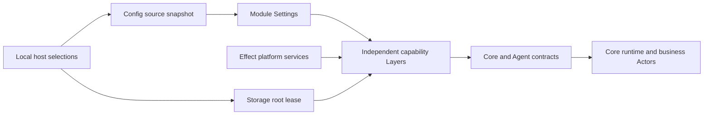

# Infrastructure review and design interview

Status: implemented and reviewed. The four confirmed design decisions are reflected in the source, host composition and tests. Baseline: `d77ff0a`.

## Scope and existing constraints

Review the entire infra package, its public consumers and test responsibilities. Design a small set of independent infrastructure capabilities, then provide a complete target file inventory with responsibilities. This document does not authorize implementation before the design interview is concluded.

Core owns domain contracts, Actor orchestration, accepted business state and recovery policy. Agent owns model execution and resolved model registration. Infra owns concrete source loading, Context persistence, decision transport, external executors and the agentmemory backend. Integrations remain a sibling package. Local chooses sources/platform implementations/adapters. Preserve accepted-state-before-acknowledgement, uncertain external outcomes, capture drain, root lease ownership and credential isolation. Existing-data compatibility is not a design goal.

## Resolved decisions

1. **Independent capability Layers — accepted.** Split Context persistence from external executors. Local chooses and composes the independent Layers; core consumes its existing capabilities. Remove the combined `ConfiguredDurableInfrastructure` entry point rather than keeping it as a compatibility facade.

2. **Remove independent Goal screening audit storage — accepted.** Remove FileGoalScreening and GoalScreeningStore, retaining ordinary structured logs and authoritative routing/Goal inputs. Complete calibration samples are no longer a product requirement. ADR 0050 supersedes ADR 0041. ADR 0050 records the implemented removal.

3. **Direct System One HTTP transport — accepted.** Replace @typesafe-ai/sdk with Effect HttpClient for the existing JSON endpoint. Preserve endpoint/query authentication, optional Bearer authentication, cancellation, error privacy, language behavior and bounded retries.
4. **Unified application-owned directories — accepted.** Default Contexts, conversations, executor workspaces and memory data to the configured durable root. An explicit Memory dataDir still overrides its default. Upstream agentmemory global control files remain an explicitly isolated native requirement.

## Existing requirements retained

- The host-managed agentmemory daemon remains the default, as accepted in ADR 0037. This review does not add remote/managed modes or daemon-selection configuration.
- Core owns the durable Memory capture queue and retry policy. The backend owns the lifetime of already-admitted transport work and drain before daemon release; cancelling an observer must not silently cancel or abandon that work.
- Existing Codex and Doubao identifiers and supported operations remain. Unsupported Doubao follow-up remains an explicit failure; the refactor adds no new executor feature.
- Context native transaction, message ordering/deletion, recovery fencing, source-event privacy and root lease invariants remain.
- Native Pi callbacks, the SQLite filesystem ownership primitive, external PID control and the self-contained Doubao renderer script are explicit native boundaries. Ordinary orchestration, filesystem reads, CLI processes, HTTP, retries, timers and synchronization use Effect capabilities.
- No additional configuration registry, generic Platform/Manager hierarchy, compatibility facade or externally supplied Layer per internal helper is introduced.

## Findings and candidate changes

| Finding                                                  | Evidence                                                                                                                                                 | Candidate direction                                                                                                                                 |
| -------------------------------------------------------- | -------------------------------------------------------------------------------------------------------------------------------------------------------- | --------------------------------------------------------------------------------------------------------------------------------------------------- |
| Unrelated capabilities acquired together                 | `storage/configured.ts` constructs both native Context persistence and `makeExternalAgents`                                                              | Accepted: independent Context and executor Layers                                                                                                   |
| Configured root is bypassed by task workspaces           | Codex defaults to `homedir()/.aster/tasks`; Doubao directly constructs that same directory                                                               | Accepted: default task workspaces and memory data to the configured durable root; explicit memory paths still override                              |
| Protocol/process/operation responsibilities overlap      | `codex/agent.ts` contains process spawn, JSON-RPC, unvalidated `any` payloads, approval mapping, workspaces and shutdown                                 | Separate private transport/protocol handling from the executor contract; keep one scoped connection owner                                           |
| Promise facade duplicates the domain execution interface | `external-agent.ts` repeats every execution method, while concrete drivers implement application orchestration as Promises                               | Construct core execution capabilities directly as Effects; remove the parallel Promise driver interface and bridge after concrete executors migrate |
| Memory client combines independent responsibilities      | `agentmemory/client.ts` owns HTTP, capture completion, retrieval, SQLite provenance and active Promise tracking                                          | Separate transport, provenance and admitted capture lifetime without duplicating core's durable queue                                               |
| Memory index is both entry point and implementation      | `agentmemory/index.ts` acquires the backend, resolves credentials, writes a connection file, defines a CLI reader and exports all helpers                | Keep a dedicated capability Layer; make internal implementation private; retain one intentional reader entry                                        |
| Optional audit storage is on the business critical path  | Screening append/fsync failure becomes a failed Goal target; no runtime/product reader exists                                                            | Accepted: remove the independent store and its optional dependency from core; retain business decisions and structured logs                         |
| Configuration and errors use several shapes              | Some Settings return Redacted values; constructors later validate raw settings with thrown errors; native factories choose their own home defaults       | Resolve module settings once; typed expected failures; pass explicit native inputs                                                                  |
| Environment policy is scattered                          | Executor filtering, agentmemory provider masking, secret reference resolution and native endpoint selection have different owners                        | Separate captured source data, executor environment policy and provider-specific memory environment translation                                     |
| Doubao duplicates prepared executor policy               | Core Task preparation already includes its frozen executor prompt; Doubao submit prepends the prompt again                                               | Submit the prepared Task exactly once; advertise provider policy to core without applying it again                                                  |
| Doubao wait recovers too broadly                         | Its catch branch re-queries status for every non-abort error                                                                                             | Restrict fallback to recognized CLI wait timeout/status outcomes; preserve malformed protocol and other failures                                    |
| Response decoding is inconsistent                        | Codex uses Promise<any> and unvalidated notifications; memory casts JSON bodies; the System One SDK parses JSON without validating the returned contract | Decode native envelopes at the transport boundary before using them                                                                                 |
| Public export surface exceeds host needs                 | Root/index and memory/index use broad re-exports of factories, readers, decoders, status helpers, errors and internal bridging                           | Explicit host capability exports; test internal implementations through relative imports                                                            |
| Native code has necessary and unnecessary parts          | Pi/renderer callbacks and SQLite kernel locks are native; HTTP loops, timeout registries, filesystem reads and polling are also handwritten              | Preserve required native boundaries and move ordinary orchestration/I/O to the matching Effect capabilities                                         |

## Baseline file inventory

Every baseline package file is listed below. The target inventory and disposition tables describe the implemented refactor.

| Current file                         | Responsibility                                                                                                             |
| ------------------------------------ | -------------------------------------------------------------------------------------------------------------------------- |
| `README.md`                          | Package capabilities, ownership, composition and native persistence documentation.                                         |
| `package.json`                       | Package dependencies, root exports and build/test commands.                                                                |
| `src/agentmemory/README.md`          | Pinned upstream memory process/protocol ownership and durability limitations.                                              |
| `src/agentmemory/backend.ts`         | Bridge capture/drain and public backend metadata into core MemoryBackend.                                                  |
| `src/agentmemory/client.ts`          | HTTP protocol, capture/compression completion, progressive recall, SQLite provenance and admitted Promise tracking.        |
| `src/agentmemory/errors.ts`          | Adapter-specific memory errors and redundant re-exports of core memory errors.                                             |
| `src/agentmemory/index.ts`           | Memory backend acquisition, credential resolution, daemon/connection-file ownership, configured CLI reader and re-exports. |
| `src/agentmemory/reader.ts`          | Decode the connection file and own a read-only provenance/client resource.                                                 |
| `src/agentmemory/recall.ts`          | Bridge search/expand into typed, cancellable core MemoryRecall Effects.                                                    |
| `src/agentmemory/runtime.ts`         | Global PID ownership, engine template generation, process launch/readiness, admitted-work drain and process cleanup.       |
| `src/agentmemory/settings.ts`        | Memory input validation, path defaults, provider constraints and native environment construction.                          |
| `src/agents.ts`                      | Construct Codex/Doubao adapters, filter their launch environment and own release.                                          |
| `src/codex/agent.ts`                 | Codex process, JSON-RPC, wire decoding, controls, execution status, workspaces, resume markers and shutdown.               |
| `src/config/credentials.ts`          | Resolve exact credential references against the captured secrets namespace.                                                |
| `src/config/location.ts`             | Captured source/project/home location contract.                                                                            |
| `src/config/models.ts`               | Decode configured model registrations, resolve credentials and construct the agent Models Layer.                           |
| `src/config/overlay.ts`              | Preserve structural keys and array lengths while applying higher-priority source leaves.                                   |
| `src/config/provider.ts`             | Acquire captured YAML/dotenv/environment sources and supply ConfigProvider, launch locations and subprocess environment.   |
| `src/config/sources.ts`              | Effect filesystem reads and YAML/dotenv decoding with redacted source failures.                                            |
| `src/doubao/delegation.ts`           | Serialized CLI invocation, workspace creation and ExternalAgent operation mapping.                                         |
| `src/doubao/native-response.ts`      | CDP target discovery/transport and a renderer-side native approval/clarification implementation.                           |
| `src/doubao/status.ts`               | Decode CLI receipts/status and project native pending controls into core contracts.                                        |
| `src/executor-settings.ts`           | Read the Doubao executor prompt declaration.                                                                               |
| `src/external-agent.ts`              | Generic Promise-driver-to-Effect bridge for external execution and adapter shutdown.                                       |
| `src/index.ts`                       | Current package exports; broadly exposes both host capabilities and internal adapter helpers.                              |
| `src/process/environment.ts`         | Filter captured environment variables for external executors.                                                              |
| `src/storage/actor-store-lock.ts`    | SQLite-backed process exclusion around the storage root, retained on defective shutdown.                                   |
| `src/storage/configured.ts`          | Currently couples Context persistence and external executor acquisition in one Layer.                                      |
| `src/storage/context-sessions.ts`    | Native Pi Document storage, owner routing, message families, metadata, source events, recovery and fsync.                  |
| `src/storage/file-goal-screening.ts` | Append and fsync independent Goal screening audit records.                                                                 |
| `src/storage/layers.ts`              | Resolve the screening directory and construct the file screening store Layer.                                              |
| `src/storage/settings.ts`            | Resolve the shared durable storage root from typed configuration and captured locations.                                   |
| `src/system-one/client.ts`           | SDK request adaptation, endpoint normalization, language instructions, cancellation, diagnostics and credential redaction. |
| `src/system-one/settings.ts`         | Resolve optional System One settings and credentials.                                                                      |
| `src/system-one/url.ts`              | Expand explicit endpoint references once and encode query substitutions.                                                   |
| `test/actor-store-lock.test.ts`      | Root lease contention, aliases, process death and retention after defective cleanup.                                       |
| `test/agentmemory-backend.test.ts`   | Interrupted capture observation and draining admitted work before resource release.                                        |
| `test/agentmemory-memory.test.ts`    | Provider environment isolation, capture completion, progressive expansion and durable source provenance.                   |
| `test/agentmemory-recall.test.ts`    | Typed recall failures and cancellation at the transport boundary.                                                          |
| `test/agentmemory-runtime.test.ts`   | Startup interruption, joined cleanup, failure propagation and scoped daemon release.                                       |
| `test/codex.test.ts`                 | Native session/control mapping, recoverable shutdown, cancellation and same-thread follow-up.                              |
| `test/config-provider.test.ts`       | Source precedence, exact credentials, captured environments and module defaults.                                           |
| `test/config-sources.test.ts`        | Injected filesystem/path, single capture and optional-dotenv NotFound behavior.                                            |
| `test/configuration-fixtures.ts`     | Test source/platform/location Layers and explicit memory settings decoding.                                                |
| `test/configured-storage.test.ts`    | Host-selected native Context Layer, configured storage root and screening path composition.                                |
| `test/context-sessions.test.ts`      | Message families, watches, layouts, restart and atomic recovery after lost acknowledgement.                                |
| `test/doubao.test.ts`                | CLI execution/status, cancellation, captured endpoint and unsupported follow-up behavior.                                  |
| `test/external-agent.test.ts`        | Generic Promise bridge laziness, typed errors, cancellation and submission identity forwarding.                            |
| `test/fixtures/actor-lock-child.ts`  | Isolated child process used to exercise real root lease contention and process death.                                      |
| `test/memory-settings.test.ts`       | Memory defaults, location resolution and complete optional capability validation.                                          |
| `test/model-settings.test.ts`        | Infrastructure model configuration, credential capture and invalid registry rejection.                                     |
| `test/native-response.test.ts`       | Renderer native approval/clarification identity and exact answer validation.                                               |
| `test/reaction-storage.test.ts`      | Frozen public evidence, privacy and corruption rejection against real native persistence.                                  |
| `test/system-one-url.test.ts`        | Endpoint interpolation, query/bearer credentials, redaction and optional API key behavior.                                 |
| `test/system-one.test.ts`            | SDK request correlation, retries, failure privacy, screening scale and output language.                                    |
| `tsconfig.build.json`                | Published declaration/JavaScript output configuration.                                                                     |
| `tsconfig.json`                      | Source/test typechecking, source export conditions and Effect diagnostics configuration.                                   |
| `tsconfig.test.json`                 | Compile source and tests into the isolated test output directory.                                                          |

## Accepted layering and execution flow

Local supplies platform implementations and selects independent ContextStorage, ExternalExecutors, ConfiguredModels, SystemOneTransport and AgentMemoryBackend Layers. Core continues to own its service graph, Actor activation, business readiness and domain shutdown. The lease outlives the complete runtime/adapter graph; a cleanup defect must not release an ownership lock while writers can still be alive.

Layers are the external resource-acquisition surface. Internal RPC clients, CLI runners, provenance stores and capture workers are private Effects returning capabilities, not a collection of separately supplied service Layers. Remove the mirrored ExternalAgentDriver/ManagedExternalAgent interfaces when the concrete executors expose core Effects and own their release through Scope.

Core prepares and freezes reviewed Task instructions, including executor policy and output language. Executors serialize that PreparedTask without prepending policy again. System One question/prompt construction owns the language instruction in core/integrations; the infrastructure client transmits the prepared request rather than changing business prompts.

Memory remains automatically managed. Its daemon owns process resources; its capture worker owns admitted observations independently of caller observation; core owns the durable pending queue. Shutdown stops domain admission/observation, drains admitted capture work, stops the worker/engine, closes provenance and releases leases. Do not replace this with caller-scoped cancellation or create another durable queue in infra.

## Direct System One protocol requirements

The installed SDK performs a JSON POST to `/v1/systemone`. It validates questions but parses response JSON without validating the returned answer contract. Its effective defaults are 10-second timeout, two retries, exponential backoff starting at 500 ms and capped at 5 seconds with 25% jitter, transient connection/timeouts, HTTP 408/429/5xx, and Retry-After up to 60 seconds. Preserve these deliberately through Effect HTTP/Schedule rather than inheriting opaque SDK defaults; malformed responses and normal nonretryable failures must not be retried.

Resolve service root, `/v1` and full endpoint forms once. Preserve configured query parameters and one-pass encoded substitutions. Omitted apiKey sends no Authorization header and does not consult a live environment fallback. Redact credentials and request/response payloads from failures/logs. Business-owned language instructions remain effective after transport migration.

## Public package surface

Export only LocalConfig, ConfigLocation, StorageSettings, withStorageLease, ConfiguredModels, ContextStorage, ExternalExecutors, SystemOneTransport, AgentMemoryBackend, openMemoryReader and configuredMemoryReader, with the types actually required by their host callers. Internal factories, Schema declarations, protocol decoders, status mappers, renderer functions, raw connection secrets and native clients remain private to their modules. Tests use relative implementation imports; test injection does not require widening root exports.

The two memory reader selections are intentional: a supplied connection file and a configuration-resolved connection file. They share one read implementation and acquire no daemon or capture writer. Keeping both is not a second backend or a compatibility pathway.

## Complete target file organization

The following lists every target source, test, fixture and package metadata file. File count is not the simplification metric: the large transport/process files acquire private seams while forwarding interfaces, duplicated orchestration and audit storage disappear. No placeholder module or generic provider registry is included.

| Target file                            | Responsibility                                                                                                                                     |
| -------------------------------------- | -------------------------------------------------------------------------------------------------------------------------------------------------- |
| `src/index.ts`                         | Explicit public host capability exports only; no recursive barrels or internal drivers/decoders.                                                   |
| `src/models.ts`                        | ConfiguredModels.layer: load registrations and resolve credentials before constructing agent Models.                                               |
| `src/config/provider.ts`               | LocalConfig.layer: snapshot sources once and supply the provider and captured launch contracts.                                                    |
| `src/config/sources.ts`                | Effect filesystem reads and source format decoding; no module-specific settings.                                                                   |
| `src/config/overlay.ts`                | Private structural overlay preserving dynamic keys and complete arrays.                                                                            |
| `src/config/credentials.ts`            | Private exact-reference credential resolver returning Redacted values.                                                                             |
| `src/config/location.ts`               | Captured configuration, project and home locations; no live process reads.                                                                         |
| `src/storage/settings.ts`              | Resolve the shared application data root once; module defaults derive their directories from it.                                                   |
| `src/storage/lease.ts`                 | Scoped native SQLite filesystem ownership and the public root lease wrapper; retain locks on failed writer cleanup.                                |
| `src/context/layer.ts`                 | ContextStorage.layer: provide only DurableContext through the native adapter at root/context-sessions.                                             |
| `src/context/session-store.ts`         | Pi Document persistence: layouts, message families, metadata/source events, atomic save, validated load, fsync and scoped close.                   |
| `src/executors/layer.ts`               | ExternalExecutors.layer: register the existing Codex/Doubao capabilities and own their scoped acquisition.                                         |
| `src/executors/environment.ts`         | Executor-specific filtering of captured launch variables; preserve native executor authentication while excluding application private values.      |
| `src/executors/codex/executor.ts`      | Core execution contract, workspace allocation, session/run ownership, controls, status, continuation and recoverable shutdown markers.             |
| `src/executors/codex/rpc.ts`           | Private app-server process/JSON-RPC transport with correlated requests, shared initialization, scoped pending work and disconnect handling.        |
| `src/executors/codex/protocol.ts`      | Schema-backed native envelopes/results and explicit status/control response transformations; opaque native metadata stays private.                 |
| `src/executors/doubao/executor.ts`     | Core execution contract over the original CLI run; submit prepared instructions once and fail explicitly for unsupported follow-up.                |
| `src/executors/doubao/cli.ts`          | Effect child-process invocation, command serialization, bounded output, timeout/error envelope decoding and cancellation.                          |
| `src/executors/doubao/protocol.ts`     | Receipt/status/question/control schemas and pure conversion to core execution contracts.                                                           |
| `src/executors/doubao/approval.ts`     | Original-run control correlation, CDP target selection and scoped renderer evaluation transport.                                                   |
| `src/executors/doubao/renderer.ts`     | Self-contained native desktop response implementation; the intentional renderer JS boundary for exact command approval and clarification.          |
| `src/executors/doubao/settings.ts`     | Resolve the existing custom executor prompt and captured endpoint; workspace defaults come from the shared storage root.                           |
| `src/memory/layer.ts`                  | AgentMemoryBackend.layer: assemble daemon, transport, provenance and capture lifetime; expose core MemoryBackend and own release.                  |
| `src/memory/settings.ts`               | Schema/defaults/provider constraints/path resolution and Redacted credential resolution; default dataDir is root/memory.                           |
| `src/memory/environment.ts`            | Pinned agentmemory CLI environment and provider-specific masks/port/model translation; unwrap credentials only at launch.                          |
| `src/memory/daemon.ts`                 | Scoped upstream process ownership, generated template, readiness and joined shutdown; isolate required global PID/native process boundaries.       |
| `src/memory/protocol.ts`               | Connection and HTTP response schemas, observation IDs and progressive recall wire types.                                                           |
| `src/memory/client.ts`                 | Effect HTTP requests and progressive search/expansion; attach source provenance and preserve ordered selected-ID results.                          |
| `src/memory/capture.ts`                | Observe/compression/end protocol and the lifetime of admitted operations; interrupted observers do not retire admitted work; drain before release. |
| `src/memory/provenance.ts`             | Private SQLite source-to-observation/session mapping, read-only lookup and resource ownership; no domain capture queue.                            |
| `src/memory/reader.ts`                 | Intentional CLI entry points for a supplied or configured connection file; acquire only read capabilities and never start the daemon.              |
| `src/memory/errors.ts`                 | Private adapter-specific expected failures; core errors are imported directly and not re-exported.                                                 |
| `src/system-one/layer.ts`              | SystemOneTransport.layer: resolve settings and provide the optional core client with an injected Effect HttpClient.                                |
| `src/system-one/settings.ts`           | Optional section validation, Redacted credentials, one-pass URL reference expansion and final endpoint normalization.                              |
| `src/system-one/client.ts`             | One JSON HTTP decision protocol: typed response decoding, bounded retry/timeout/cancellation and safe per-request structured diagnostics.          |
| `README.md`                            | Public capability selection, dependency direction, ownership and native-boundary documentation.                                                    |
| `src/memory/README.md`                 | Pinned daemon/protocol constraints, progressive recall/provenance and capture/drain durability limits.                                             |
| `package.json`                         | Keep one infra package; remove the TypeSafe SDK dependency and retain only genuinely used adapters/platform dependencies.                          |
| `tsconfig.json`                        | Source/test typechecking and Effect diagnostics against installed Effect 4.0.0.                                                                    |
| `tsconfig.build.json`                  | Build explicit public declarations and implementation output.                                                                                      |
| `tsconfig.test.json`                   | Compile source and temporary test fixtures; retain the current flat test discovery contract.                                                       |
| `test/config-provider.test.ts`         | Source precedence, structural names/arrays, credential references and environment isolation.                                                       |
| `test/config-sources.test.ts`          | Single capture with injected FileSystem/Path and precise optional-source error handling.                                                           |
| `test/configuration-fixtures.ts`       | Private test source/location/settings Layers; no public test-only adapter entry points.                                                            |
| `test/executor-fixtures.ts`            | Private scoped executor runtimes for native process and shutdown tests.                                                                            |
| `test/http-fixtures.ts`                | Injected Effect HTTP transports and resolved System One settings for deterministic tests.                                                          |
| `test/memory-fixtures.ts`              | Private scoped memory transport/provenance/capture assembly for tests.                                                                             |
| `test/model-settings.test.ts`          | Resolved model registration and unavailable/invalid credentials before execution.                                                                  |
| `test/storage-settings.test.ts`        | Unified default paths under the configured root and explicit memory path overrides.                                                                |
| `test/storage-lease.test.ts`           | Contention, path aliases, process death and retained ownership after defective shutdown.                                                           |
| `test/fixtures/storage-lease-child.ts` | Isolated child used only to verify real filesystem lease behavior.                                                                                 |
| `test/context-storage.test.ts`         | Context capability acquisition independent of executor registration and configured-root selection.                                                 |
| `test/context-sessions.test.ts`        | Native families, watches, layouts, restart, no-op replay and atomic handoff recovery.                                                              |
| `test/context-events.test.ts`          | Frozen public event evidence, private-state exclusion and corruption rejection without rewriting storage.                                          |
| `test/codex.test.ts`                   | Executor session/run behavior, same-thread follow-up, original-work recovery and scoped shutdown.                                                  |
| `test/codex-rpc.test.ts`               | RPC/thread schema validation and retired-transport rejection; executor tests cover correlation and cancellation.                                   |
| `test/doubao.test.ts`                  | Execution/status/native controls, precise wait recovery and exactly-once prepared prompt composition.                                              |
| `test/doubao-cli.test.ts`              | Serialization, queued cancellation, bounded output and known timeout/status errors with fake processes.                                            |
| `test/doubao-approval.test.ts`         | Native renderer identity, exact choices and original-run association.                                                                              |
| `test/memory-settings.test.ts`         | Complete optional capability validation, credential resolution and rooted paths.                                                                   |
| `test/memory-environment.test.ts`      | Provider masks, endpoint/model/port translation and independent embedding constraints.                                                             |
| `test/memory-protocol.test.ts`         | Malformed responses, tagged transport failures and connection credential privacy.                                                                  |
| `test/memory-capture.test.ts`          | Compression completion, failed captures, interrupted observation, joined drain and shutdown ordering.                                              |
| `test/memory-provenance.test.ts`       | Durable source mappings and consolidated-memory provenance across reopen.                                                                          |
| `test/memory-recall.test.ts`           | Selected-only progressive expansion, caps, ordering, typed errors and cancellation before fallback requests.                                       |
| `test/memory-daemon.test.ts`           | Startup/readiness failure, explicit process ownership and joined cleanup using fake transports/processes.                                          |
| `test/system-one.test.ts`              | Effect HTTP protocol, isolated request diagnostics, retry/timeout/abort and malformed answer handling.                                             |
| `test/system-one-url.test.ts`          | Endpoint/query interpolation, absent/present Bearer authentication, exact expansion and privacy.                                                   |

## Disposition of every current file

| Current file                         | Disposition                                                                                                       |
| ------------------------------------ | ----------------------------------------------------------------------------------------------------------------- |
| `README.md`                          | Update to accepted public capability organization                                                                 |
| `package.json`                       | Remove SDK dependency; keep a single package                                                                      |
| `src/agentmemory/README.md`          | Move to src/memory/README.md                                                                                      |
| `src/agentmemory/backend.ts`         | Merge into memory/layer.ts                                                                                        |
| `src/agentmemory/client.ts`          | Split into memory/client.ts, protocol.ts, capture.ts and provenance.ts                                            |
| `src/agentmemory/errors.ts`          | Move to memory/errors.ts; remove core-error forwarding                                                            |
| `src/agentmemory/index.ts`           | Delete barrel/implementation mix; use memory/layer.ts and reader.ts                                               |
| `src/agentmemory/reader.ts`          | Move to memory/reader.ts; preserve the two intentional CLI source selections                                      |
| `src/agentmemory/recall.ts`          | Merge into direct Effect recall implementation in memory/client.ts                                                |
| `src/agentmemory/runtime.ts`         | Rewrite as memory/daemon.ts; use Effect orchestration around native boundaries                                    |
| `src/agentmemory/settings.ts`        | Split into memory/settings.ts and environment.ts                                                                  |
| `src/agents.ts`                      | Replace with executors/layer.ts                                                                                   |
| `src/codex/agent.ts`                 | Split into codex/executor.ts, rpc.ts and protocol.ts                                                              |
| `src/config/credentials.ts`          | Keep private                                                                                                      |
| `src/config/location.ts`             | Keep                                                                                                              |
| `src/config/models.ts`               | Move to src/models.ts                                                                                             |
| `src/config/overlay.ts`              | Keep private                                                                                                      |
| `src/config/provider.ts`             | Keep source ownership                                                                                             |
| `src/config/sources.ts`              | Keep                                                                                                              |
| `src/doubao/delegation.ts`           | Split into doubao/executor.ts and cli.ts; stop duplicating prepared policy                                        |
| `src/doubao/native-response.ts`      | Split into doubao/approval.ts and renderer.ts                                                                     |
| `src/doubao/status.ts`               | Move to doubao/protocol.ts                                                                                        |
| `src/executor-settings.ts`           | Move into executors/doubao/settings.ts                                                                            |
| `src/external-agent.ts`              | Delete Promise interface/bridge; executors expose Effects directly                                                |
| `src/index.ts`                       | Rewrite explicit exports                                                                                          |
| `src/process/environment.ts`         | Move to executors/environment.ts                                                                                  |
| `src/storage/actor-store-lock.ts`    | Move to storage/lease.ts; retain native ownership guarantees                                                      |
| `src/storage/configured.ts`          | Delete; replace with context/layer.ts and executors/layer.ts                                                      |
| `src/storage/context-sessions.ts`    | Move to context/session-store.ts; preserve native persistence invariants                                          |
| `src/storage/file-goal-screening.ts` | Delete independent screening audit adapter                                                                        |
| `src/storage/layers.ts`              | Delete screening Layer                                                                                            |
| `src/storage/settings.ts`            | Keep; make other default directories derive from root                                                             |
| `src/system-one/client.ts`           | Replace SDK implementation with system-one/client.ts and layer.ts                                                 |
| `src/system-one/settings.ts`         | Keep; complete normalization in settings                                                                          |
| `src/system-one/url.ts`              | Merge into system-one/settings.ts                                                                                 |
| `test/actor-store-lock.test.ts`      | Rename to storage-lease tests                                                                                     |
| `test/agentmemory-backend.test.ts`   | Merge into memory-capture tests                                                                                   |
| `test/agentmemory-memory.test.ts`    | Split into memory-environment, memory-capture, memory-provenance and memory-recall tests                          |
| `test/agentmemory-recall.test.ts`    | Move/merge into memory-recall and memory-protocol tests                                                           |
| `test/agentmemory-runtime.test.ts`   | Move to memory-daemon tests                                                                                       |
| `test/codex.test.ts`                 | Keep end-to-end contract tests; extract transport cases to codex-rpc tests                                        |
| `test/config-provider.test.ts`       | Keep                                                                                                              |
| `test/config-sources.test.ts`        | Keep                                                                                                              |
| `test/configuration-fixtures.ts`     | Keep private; adjust rooted paths and Effect dependencies                                                         |
| `test/configured-storage.test.ts`    | Rename to context-storage tests; remove screening and executor coupling assertions                                |
| `test/context-sessions.test.ts`      | Keep                                                                                                              |
| `test/doubao.test.ts`                | Keep executor contracts; extract CLI cases to doubao-cli tests                                                    |
| `test/external-agent.test.ts`        | Delete bridge-only tests; move cancellation/unknown-outcome invariants to concrete executor tests                 |
| `test/fixtures/actor-lock-child.ts`  | Rename to fixtures/storage-lease-child.ts                                                                         |
| `test/memory-settings.test.ts`       | Keep and extend root defaults/credential validation                                                               |
| `test/model-settings.test.ts`        | Keep; import the relocated private model adapter                                                                  |
| `test/native-response.test.ts`       | Rename to doubao-approval tests                                                                                   |
| `test/reaction-storage.test.ts`      | Rename to context-events tests                                                                                    |
| `test/system-one-url.test.ts`        | Keep endpoint/auth/privacy contracts; remove SDK-specific patch assumptions                                       |
| `test/system-one.test.ts`            | Rewrite against injected HttpClient; move domain screening/language expectations to owning core/integration tests |
| `tsconfig.build.json`                | Keep                                                                                                              |
| `tsconfig.json`                      | Keep                                                                                                              |
| `tsconfig.test.json`                 | Keep flat discovery                                                                                               |

## Necessary changes outside infra

- `apps/local/src/services.ts`: select the independent capability Layers and the Effect HTTP platform implementation; remove the combined infrastructure/screening Layer.
- `apps/local/src/configuration.ts` and CLI readers: provide the shared root/settings/platform graph and use only public source/reader entry points.
- Core runtime and reaction/screening modules: remove GoalScreeningStore and its error/append plumbing; retain score/threshold/source identities needed by actual routing and Goal admission.
- Core/integration System One question builders: apply the shared output-language rule before transport. Preserve existing default Chinese behavior.
- Test helpers and cross-package tests: consume the smaller public package surface and assert standalone capability acquisition, prepared-instruction fidelity and rooted paths.
- Package README, runtime/configuration design and ADR 0041/0050: align public names and record the intentional loss of independent calibration samples. CONTEXT.md no longer defines a removed screening audit dataset.

These are direct consequences of the package interface changes, not a migration of domain workflows into infra. Actor, Goal, Signal, Task and Memory business ownership remains unchanged.

## Implementation sequence and validation

1. Establish independent Layer composition, explicit exports and rooted settings; update host consumers.
2. Remove independent Goal audit storage and core's optional audit dependency.
3. Replace the System One SDK with an injected Effect HTTP protocol and move language composition to question builders.
4. Separate Codex RPC/protocol/execution and Doubao CLI/protocol/renderer response; remove duplicate prompt insertion and the Promise driver bridge.
5. Separate memory daemon, transport, capture lifetime and provenance; preserve admitted-work drain and CLI read-only ownership.
6. Delete obsolete files/exports and relocate tests/documentation with their responsibilities.

Use fake transports/processes, injected FileSystem/Path/HttpClient, Deferred and TestClock where timing affects behavior. Keep real temporary native persistence/SQLite tests for ownership and recovery. Verify no duplicate submissions or prompt policy, exact pending-control identities, cancellation before subsequent effects, joined shutdown, root alias contention, source-event privacy, malformed response failure, selected-only memory expansion, durable provenance, configuration arrays and nonblank credentials. Finish with workspace build/tests/check and affected Effect diagnostics. Never call real models/executors/messaging or modify existing runtime files for validation.

Implementation is complete. The target inventory matches all 68 package files. The obsolete live-model summary verification script was removed because it depended on retired public APIs; integration/core tests cover those boundaries with injected models.

## Review completion

Standards review found four issues: capture defects could disappear after FiberMap removed completed workers; daemon launch and lease acquisition had interruption gaps before release registration; native approval reader defects became ordinary failures. Each is fixed with retained defect observation, atomic acquireRelease enrollment, and Deferred completion from the original failure Exit. Re-review found no residual issues.

Spec review found the daemon launch gap and insufficient recall hit/fallback decoding. Native identities, details and consolidated-memory provenance now decode before use while opaque fields remain available. Re-review found no residual issues.

Validation uses isolated native temporary storage and fake HTTP/process transports. Final verification:

- `pnpm test`: workspace build and all 504 tests passed (agent 44, actor 56, core 187, infra 63, integrations 125, local 29).
- `pnpm check`: lint, formatting and workspace typechecking passed.
- Effect diagnostics: zero errors and zero warnings for infra, core, integrations and local.
- Independent Standards and Spec re-reviews found no residual issues; targeted Memory regressions passed 6/6.
- No real model, external executor or messaging service was invoked; all native persistence/lease tests used temporary directories.
- The existing Vite chunk-size advisory remains; browser behavior was unchanged.
