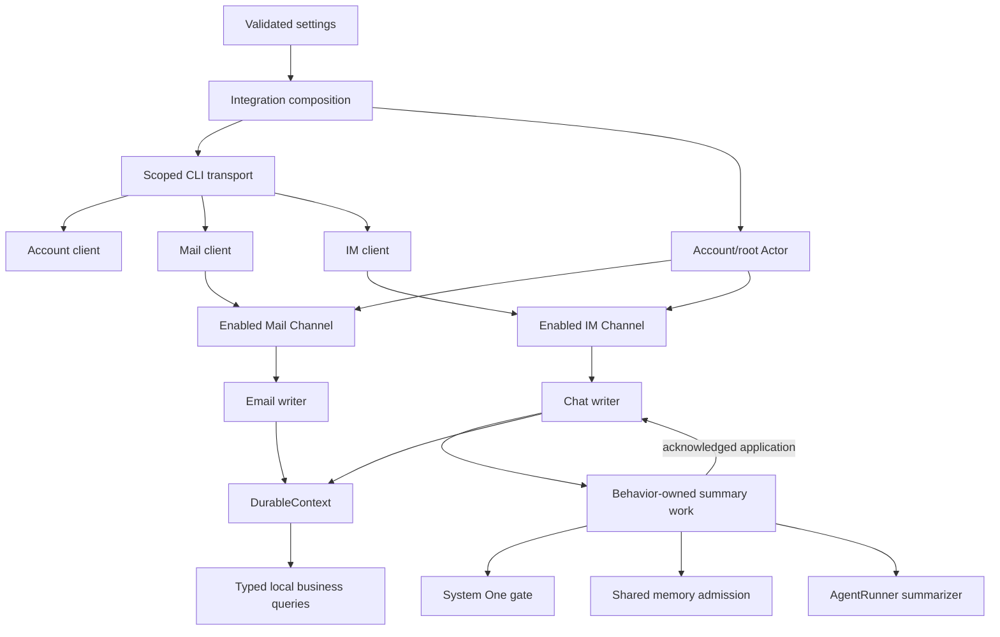

# Lark reference integration review

Status: implemented and reviewed, 2026-10-10. Workspace build, 495 tests, lint/format/type checks and affected Effect diagnostics passed.

## Objective

Review the complete Lark integration against the current Actor, Effect, DurableContext, query, configuration and runtime capabilities. Establish a clear reference implementation that future integrations can follow. Preserve business responsibilities deliberately; historical implementation shape is not the design contract.

Review account identity, Mail, IM retrieval, Chat ownership, summary execution and admission, transport, parsing, errors, configuration, installation, readiness, recovery, cancellation, exports and tests. Shared framework changes require a concrete gap demonstrated by this integration; avoid speculative integration frameworks.

## Established constraints

- Actors own scheduling and business state transitions; runtime owns activation and shutdown.
- Domain methods use Effect 4; SDK/process boundaries are isolated and cancellable.
- Durable acceptance precedes acknowledgement and retrieval cursor advancement.
- Generic Context evidence is committed serialized state text; business queries have explicit schemas.
- IM messages are immutable while retained, keyed by source message ID. Incoming retained IDs are ignored. Summary completion saves state and removes covered IDs atomically.
- Removed IM messages leave no fingerprints or historical deduplication receipts. Overlapping retrieval or crash replay may append a removed ID again.
- Summary assessment deferrals and finite retry budgets are local to the owning Behavior; accepted pending evidence and summaries survive restart.
- Existing uncommitted user changes must be preserved.

## Initial observations

These are starting points for investigation, not accepted redesign decisions.

| Area                    | Current source-backed behavior                                                                                                                                                                                                                        | Design question                                                                                              |
| ----------------------- | ----------------------------------------------------------------------------------------------------------------------------------------------------------------------------------------------------------------------------------------------------- | ------------------------------------------------------------------------------------------------------------ |
| Capability activation   | `config.ts` always constructs Mail settings; the root always starts Mail. IM is optional, but `integration.ts` constructs all IM service Layers, including admission persistence, even when IM is absent.                                             | Which configured capabilities should acquire resources and own Contexts?                                     |
| Lifecycle and readiness | Root startup waits for child startup. Integration readiness separately subscribes to Context changes and reads the IM ready flag; first IM catch-up gates readiness, while account/Mail profile fetches run asynchronously.                           | What do installed, started, caught-up and healthy mean, and which failures should prevent runtime readiness? |
| Transport               | `shared/cli.ts` uses promisified native `execFile`, a fixed deadline/output limit and `process.env` captured separately on each call. Account, Mail and IM construct their own Promise adapters.                                                      | Which existing process/environment capabilities should own execution, cancellation and diagnostics?          |
| Decoding and errors     | Shared `object`/`string` helpers provide permissive defaults; clients mix parsing helpers and schemas. Actor result envelopes often accept generic Error, while query contracts have separately reconstructed provider errors.                        | Where should unknown data be decoded, and how should typed failures reach queries, polling and supervision?  |
| State and recovery      | IM owns durable retrieval cursor and daily coverage; Mail owns a volatile cursor and replays today using retained Email Contexts. Profile refresh failures are logged. Chat summary execution has separate generation, admission and retry ownership. | Which differences are domain requirements, and which are leftover implementation choices?                    |
| API and module shape    | The barrel exports many parsers, Actors and internal work helpers. Clients expose inconsistent construction/injection patterns.                                                                                                                       | What is the supported integration API, and what remains private implementation?                              |

Source entry points: `packages/integrations/src/lark/integration.ts`, `config.ts`, `account/root-actor.ts`, `mail/channel-actor.ts`, `im/channel-actor.ts`, `im/chat-actor.ts`, `im/summary/work.ts`, `im/summary/agent-queue.ts`, `shared/cli.ts` and `index.ts`.

## Accepted decisions

### Explicit capability activation

Accepted on 2026-10-10. The Lark root owns account identity and shared transport. Mail and IM are enabled only when their corresponding child configuration is present. An absent child acquires no capability-specific services, Actors, background work or Contexts. Child configuration is the single enablement mechanism; do not introduce an additional `enabled` flag.

Resolve capability configuration before constructing its Layers. Disabling IM must not acquire its summarizer, gate, admission queue or admission timing Context. Disabling Mail must not construct its mailbox/message owners or start polling. Runtime retains ownership of activation and shutdown.

### Single-account scope

Accepted on 2026-10-10. Keep one Lark account and the existing `/lark`, `/lark/mail` and `/lark/im` address layout. Multi-account namespaces and account-switching behavior are outside this review's current scope. `profile` remains the CLI credential selector; do not introduce account directories or a new account-management subsystem in this refactor.

### Runtime lifecycle excludes business readiness

Accepted on 2026-10-10. Runtime owns integration activation, framework initialization, supervision boundaries and shutdown. First retrieval, catch-up, remote connection status and business retries belong entirely to the owning Actors. Runtime does not inspect Context state or wait for these business outcomes.

Remove business `IntegrationHandle.ready` effects and the corresponding runtime wait. Do not replace them with another integration-specific readiness protocol or a Context subscription. Native Actor lifecycle primitives remain available for framework startup; they do not promise remote data availability. Integration Layers capture dependencies, acquire enabled resources and register their roots; Actors own subsequent business work. Apply the shared contract consistently to other integrations where needed.

Business commands report unavailable data through their domain error contracts when no usable local data exists. Configuration/acquisition failures and Actor defects retain their framework error and supervision semantics. A network failure is not a successful business result, and it does not become a runtime readiness condition.

### One retrieval checkpoint per Channel

Accepted on 2026-10-10. IM and Mail each persist a single `through` retrieval checkpoint in their own Context State. Advance it only after every affected child Actor acknowledges durable ingress. Delete IM daily retrieval-interval Contexts and their interval-merging helper. Do not introduce a generic polling framework.

Polling windows, overlap, catch-up and retry scheduling remain in the owning Channel/domain code. Startup keeps today's lower bound; accepted pending Chat work can still resume from a prior day independently of remote retrieval. Removing daily coverage does not authorize historical backfill or change summary completion guarantees.

### Separate code responsibilities without adding IM modes

Accepted on 2026-10-10. Enabling IM still enables its existing product behavior: queries, automatic retrieval and rolling summaries. Do not add a query-only mode or make summary-block absence silently disable automatic collection. Enabled IM requires a valid summary model; validate its full configuration consistently instead of allowing incomplete entries through one boundary and failing later in another.

Separate provider queries, Channel ingestion and Chat summary execution in code. Query implementations depend on their provider/read capabilities rather than invoking summary orchestration. Channel code owns retrieval and durable handoff. Chat code owns pending evidence and summary application, while summary work owns model execution, gating, bounded batching and admission. Composition wires these responsibilities without introducing new product configuration.

### Separate durable and transient state

Accepted on 2026-10-10. Durable State contains business facts and information required to recover accepted work. Transient Actor/worker state contains execution coordination and recent operational observations. Keep these definitions and ownership visibly separate rather than persisting an entire Behavior state object.

| State                                                                             | Ownership and lifetime                                                       |
| --------------------------------------------------------------------------------- | ---------------------------------------------------------------------------- |
| Account/mailbox identity, retained emails, Chat identity and rolling summary      | Durable owner Context State                                                  |
| Pending Chat messages                                                             | Durable immutable message family members until summary completion            |
| Channel `through` checkpoint                                                      | Durable State; advance after child durable acknowledgement                   |
| Chat `flushThrough` obligation                                                    | Durable State while accepted pending work remains covered by that obligation |
| Polling/running flags, generation, scoped workers and timers                      | Transient owner Behavior state                                               |
| Summary assessment deferrals, selected execution batches and finite retry budgets | Transient summary-work state; retained pending evidence remains durable      |
| IM `ready`, latest-poll `chats` count and `lastError`                             | Remove from durable State; keep only necessary local observations/logging    |

Queries report their own typed business failures; Runtime does not consume operation-state flags. Do not add a persistent health state machine or status service to replace the removed fields.

### Integration-scoped admission timing

Accepted on 2026-10-10. Summary concurrency and start spacing apply only within the current integration Scope. Delete the durable `lastStart` checkpoint, `/lark/im/admission` Context and persistence callbacks. A restarted integration begins a fresh limiter; accepted Chat evidence and summary recovery remain independently durable.

Keep existing in-process admission requirements: bounded running summaries, configured minimum spacing between starts, fair queued admission, cancellation of queued/running work and release of shared capacity before retry delays. Check the installed Effect 4 APIs before selecting the implementation. Its memory-backed RateLimiter reserves tokens before its sleep, so it is not automatically equivalent to cancellation that leaves no reserved start slot. Avoid maintaining a worker pool or duplicate per-chat lifecycle checks when existing Effect primitives and Chat ownership can express the actual contract.

### Expected business failures remain Actor-owned

Accepted on 2026-10-10. Typed polling or durable-handoff failures preserve committed data and the last successful `through` checkpoint, then retry at the normal polling interval. Do not introduce a failure budget, suspended-state persistence or manual-resume command for polling.

On-demand queries return typed errors directly without implicit retries. Summary keeps its existing bounded transient retries and capacity-reduction policy. Defects enter Actor supervision and interruption retains cancellation semantics; neither becomes an ordinary retry or success. Account/mailbox profile recovery follows the accepted restore-and-refresh rule below.

### Local retained Chat directory

Accepted on 2026-10-10. `list_chats` describes Chat identities already observed and retained locally, regardless of whether their Actors are currently active. `summary` reads the locally saved rolling summary. `messages` queries provider history on demand. Do not add a provider-wide chat-list capability.

Directory membership follows business Context identity, not encoded Actor names or Actor liveness. Keep local discovery separate from remote history and expose their actual coverage in the query contract. Dormant retained data remains part of the directory; missing or failed data is not silently replaced with an empty successful reply.

### Read retained data without activating its writer

Accepted on 2026-10-10. Lark's explicit business-query handlers read schema-decoded committed durable data without activating the corresponding writer Actor. Return only the declared Chat identity, summary, account/mailbox profile or EmailData response. Generic Context reads remain text-only; do not add a generic raw-State/pending-message transport API or reconstruct structured views by parsing Context text.

The query remains a Lark domain capability. Owner Actors retain all mutations, accepted-work recovery and model scheduling. Querying saved data does not trigger automatic ingestion, summary execution or writer activation. Mail's retained/provider fallback policy and missing-data responses remain explicit query semantics. Remove child read commands and cross-Actor asks that exist solely to return already committed snapshots.

### Activate writers for work and passivate completed owners

Accepted on 2026-10-10. At startup, recover Chat writers with accepted pending messages or an unfinished flush obligation. Leave completed identity/summary records dormant. New ingress activates its writer when needed. Keep Chat writers active while pending evidence, queued admission, model execution or retry work remains. After all work completes, allow idle writers to passivate. Enabled Channels remain alive to poll; business queries do not affect writer liveness.

Use native Actor lifecycle support rather than an ad hoc timer registry. Before enabling this for Chat, address the concrete gaps: ReceiveTimeout cannot currently be disabled and its idle stop checks mailbox/children but not outstanding Behavior effects. Suspend idle passivation while domain work remains, and ensure framework background work prevents accidental idle stops. Startup work discovery needs typed internal committed-message reads or equivalent owner recovery inspection; do not duplicate message presence in a persisted pending flag solely for discovery. Preserve revoked-handle, cancellation and late-result generation protections when writers stop or restart.

### Startup retrieval is bounded to today

Accepted on 2026-10-10. Restart resumes retrieval from the later of today's Beijing midnight and the valid committed `through` minus overlap. With no valid checkpoint, begin at today's midnight. The startup lower bound remains fixed during continuous polling so it can finish the preceding day's tail across midnight.

Do not automatically backfill unobserved intervals from earlier offline days. Already accepted pending Chat evidence and unfinished flush obligations still recover independently of remote retrieval. Historical data remains available through explicit provider queries. A `through` checkpoint records a successfully completed retrieval endpoint, not proof that every earlier remote message was imported.

### Restore and refresh account/mailbox profiles

Accepted on 2026-10-10. Restore cached profile data immediately. At each owner startup, refresh the profile asynchronously and retry typed failures at a fixed interval until a fetch succeeds. Preserve the committed cached profile during failures. Commit a successful profile refresh and end that startup refresh cycle.

Do not add continuous profile polling, persisted retry budgets or manual refresh/recovery commands. Profile queries remain local reads and do not trigger remote requests. Defects and interruption retain their framework semantics; runtime readiness does not depend on profile freshness.

### Stable public query errors

Accepted on 2026-10-10. Every public Lark query declares ContextQueryError with stable kind/message fields. Do not expose CLI execution errors, decoder error class names or original cause objects in query responses.

Provider clients and workflows retain typed internal errors and their original causes. Map expected failures only at the query boundary, preserving useful distinctions such as invalid-input, unavailable, timeout and failed. Defects and interruption are not converted into ordinary business replies. Remove duplicate provider-error schemas from Mail and IM query declarations.

### Explicit public module surface and full rewrite

Accepted on 2026-10-10. Export the integration entry, business data/query contracts and genuinely supported dependency-injection service contracts explicitly. Actor implementations, parsers, polling helpers, state transitions and admission mechanics stay internal. Cross-package tests use a narrow testing entry where necessary; production exports do not preserve old fixture imports.

The user accepts rewriting the complete Lark implementation and replacing the existing file structure. File boundaries follow responsibility and ownership, not historical layout. Preserve the agreed business contracts and incorporate the user's existing direct-Match receive style into rewritten Actors. Do not retain compatibility forwarding files or historical storage migration paths.

## Engineering baseline

The following implementation constraints come from AGENTS.md and the current framework capabilities; they do not add product modes or business state machines.

- Use one shared Effect CLI execution capability for Account, Mail and IM. Acquire profile/environment inputs once, consume the host's captured ProcessEnvironment, and use the pinned scoped ChildProcessSpawner. Keep direct argv execution, cancellation, a deadline and bounded output; drain stderr while collecting a bounded diagnostic. Avoid separate Promise adapters and repeated process.env reads in domain clients.
- Decode the CLI JSON/envelope at the transport boundary and each endpoint payload with its explicit Schema. Remove permissive object/string casts that turn malformed values into empty successful data. Optional fields may have deliberate defaults; required identifiers, timestamps, pagination and requested-result completeness must be validated.
- Normalize configuration once into typed settings. Enabled capabilities validate their complete settings before acquisition; disabled capabilities acquire no resources. Keep core Actor/Agent dependencies visible and reuse provided instances; do not install unrelated live services while assembling a capability for tests.
- Actor mailboxes own scheduling, mutations and handoff acknowledgements. Helpers may contain pure transformations or focused Effect workflows; do not introduce forwarding services/Layers for every helper or a generic polling framework.
- Keep the current caller Effect Context through transport/model boundaries and give every worker, wait and limiter a clear owning Scope. Preserve cancellation, admitted-write drain and generation protection.
- Internal read capabilities must require explicit schemas and return committed data. Generic Context transport reads remain text-only; private pending messages are used for internal recovery, not generic query dumps.

## Decision sequence

1. Capability activation and resource ownership.
2. Account identity and Context address ownership.
3. Startup, readiness, ongoing health and failure isolation.
4. Transport, decoding and typed error boundaries.
5. State, recovery and query contracts for each capability.
6. Summary execution, admission, concurrency and cancellation.
7. Public API, module organization and behavioral verification.

Proceed one decision at a time. Update the design and glossary when a decision is confirmed; use an ADR only for a meaningful architectural trade-off. Implementation begins after the design is agreed.

## Complete target file structure

The target has 30 production TypeScript files, one narrow testing entry and the maintained README. This count is a consequence of the responsibilities below, not a size target. Small internal protocols stay with their Actor; data, transport, query and execution boundaries stay separate.

```text
packages/integrations/src/lark/
  README.md
  index.ts
  integration.ts
  settings.ts
  cli.ts
  errors.ts
  paths.ts
  dates.ts
  captures.ts
  testing.ts
  account/
    model.ts
    client.ts
    actor.ts
    queries.ts
  mail/
    model.ts
    client.ts
    polling.ts
    actor.ts
    email-actor.ts
    queries.ts
  im/
    model.ts
    client.ts
    polling.ts
    actor.ts
    queries.ts
    chat/
      state.ts
      actor.ts
    summary/
      admission.ts
      gate.ts
      summarizer.ts
      work.ts
      errors.ts
```

Every listed file has one responsibility. No additional `utils`, generic `service`, snapshot forwarding module, or generic integration/polling framework is needed.

### Entry and shared boundaries

| File             | Responsibility                                                                                                                                                                                                                | Boundary                                                                                                                                     |
| ---------------- | ----------------------------------------------------------------------------------------------------------------------------------------------------------------------------------------------------------------------------- | -------------------------------------------------------------------------------------------------------------------------------------------- |
| `README.md`      | Explain configuration, enabled capabilities, public queries, ownership, persistence and recovery guarantees.                                                                                                                  | Describes actual supported behavior; does not keep old API examples.                                                                         |
| `index.ts`       | Explicitly export the integration entry, supported client/settings contracts, business schemas and query contracts.                                                                                                           | No implementation, wildcard export or internal Actor/parser/work exports.                                                                    |
| `integration.ts` | Acquire normalized settings, conditionally compose enabled services, bind typed Actor dependencies, register capture policies and install the root with runtime. Expose live composition and injected installation for tests. | No polling, Context-status observation, business-ready handshake or model execution.                                                         |
| `settings.ts`    | Own configuration schemas, defaults and one normalized LarkSettings service for account, optional Mail and optional complete IM settings.                                                                                     | Missing capabilities remain absent. Invalid enabled settings fail before acquisition. No duplicate parser or process-environment precedence. |
| `cli.ts`         | Own the single Effect-native CLI transport: captured profile/environment, direct argv, scoped process execution, deadline, bounded stdout/stderr and JSON/envelope decoding.                                                  | No endpoint schema, Context access, implicit retry or business scheduling.                                                                   |
| `errors.ts`      | Define the provider error contract and narrowly map expected query failures to ContextQueryError.                                                                                                                             | Original cause remains internal. Do not fold defects or interruption into ordinary failure replies.                                          |
| `paths.ts`       | Construct and recognize account, mailbox, email and Chat Context identities; validate/encode opaque provider IDs consistently.                                                                                                | Uses public business identity. Does not decode runtime Actor names or duplicate core Actor addressing.                                       |
| `dates.ts`       | Own Beijing business dates and timestamp normalization using pinned Effect DateTime capabilities.                                                                                                                             | Shared pure calendar rules only; no timer, retry or polling ownership.                                                                       |
| `captures.ts`    | Build enabled profile Memory capture policies and stable capture identity from committed profile text.                                                                                                                        | Separate from removed IM message fingerprints. No native Memory backend, Context writer or background consumer.                              |
| `testing.ts`     | Export only internal definitions/factories genuinely required by cross-package tests.                                                                                                                                         | Separate package subpath; not re-exported by the production barrel.                                                                          |

### Account

| File                 | Responsibility                                                                                                                                                      | Boundary                                                                                                                        |
| -------------------- | ------------------------------------------------------------------------------------------------------------------------------------------------------------------- | ------------------------------------------------------------------------------------------------------------------------------- |
| `account/model.ts`   | Define AccountProfile, durable account state and its state-only text serializer.                                                                                    | Pure domain schemas/data; no CLI response assumptions or Actor refs.                                                            |
| `account/client.ts`  | Decode the account endpoint payload and implement LarkAccountClient over the shared CLI.                                                                            | Returns normalized profile data; no process adapter, persistence or retry loop.                                                 |
| `account/actor.ts`   | Own the `/lark` writer, cached-profile restore/startup refresh, transient refresh coordination and enabled child creation. Keep its small completion protocol here. | Writes account state and owns Actor work. Child services are provisioned through typed composition; no dummy disabled services. |
| `account/queries.ts` | Declare the profile query and read the committed profile through its explicit business schema.                                                                      | No remote refresh or writer activation; absence is a typed unavailable result.                                                  |

### Mail

| File                  | Responsibility                                                                                                                                                                                                       | Boundary                                                                                                                                                  |
| --------------------- | -------------------------------------------------------------------------------------------------------------------------------------------------------------------------------------------------------------------- | --------------------------------------------------------------------------------------------------------------------------------------------------------- |
| `mail/model.ts`       | Define MailboxProfile, EmailData, list arguments/pages, durable mailbox state and serializers. State contains mailbox identity, cached profile and optional `through`.                                               | Public DTOs and durable schema are separate from transient polling flags; no endpoint decoding logic.                                                     |
| `mail/client.ts`      | Implement LarkMailClient endpoint methods, payload decoding, provider pagination and normalized metadata/body results.                                                                                               | No Actor scheduling, local deduplication or Context writes.                                                                                               |
| `mail/polling.ts`     | Calculate the bounded retrieval window and fetch/validate a complete window through LarkMailClient.                                                                                                                  | No cursor mutation, timer ownership, child creation or acknowledgement.                                                                                   |
| `mail/actor.ts`       | Own mailbox state, startup profile refresh, polling coordination, filtering already retained emails, writer activation, asynchronous durable handoff and checkpoint advancement. Internal result messages live here. | Mailbox owns mutations. Slow provider calls and child asks return through pipeToSelf.                                                                     |
| `mail/email-actor.ts` | Own an individual EmailData writer: validate addressed identity, persist/emit before acknowledgement and passivate when idle.                                                                                        | No GetEmail read command or retained-query activation path.                                                                                               |
| `mail/queries.ts`     | Declare profile/list/read contracts; read retained mailbox/email data directly and call the provider for list or an absent retained email.                                                                           | Query results do not advance `through`, persist fetched bodies or wake writer Actors. Corrupt retained data must not trigger a masking provider fallback. |

Changing the configured mailbox resets the mailbox-bound profile/checkpoint for that owner. Previously retained email Contexts keep their mailbox-qualified identities. This does not add multi-mailbox configuration or account switching.

### IM and Chat

| File               | Responsibility                                                                                                                                                                                                                                   | Boundary                                                                                                                                                                              |
| ------------------ | ------------------------------------------------------------------------------------------------------------------------------------------------------------------------------------------------------------------------------------------------ | ------------------------------------------------------------------------------------------------------------------------------------------------------------------------------------- |
| `im/model.ts`      | Define canonical ChatInfo, sender/message evidence, ChatSummary, provider query arguments/pages, retrieved batches and IM Channel State/serializer. Channel State contains optional `through`.                                                   | One normalized message schema; transport-only fields are removed at decode, not repeatedly before every model call.                                                                   |
| `im/client.ts`     | Implement LarkImClient search/history/mute-setting operations with endpoint schemas, paging, exact window filtering and normalized results.                                                                                                      | No summary dependency, Actor lookup, Context writer or native process duplication.                                                                                                    |
| `im/polling.ts`    | Select today's restart lower bound, overlap and bounded catch-up window, then retrieve its batches through LarkImClient.                                                                                                                         | No durable mutation, scheduling or daily interval records.                                                                                                                            |
| `im/actor.ts`      | Own IM progress and transient polling coordination; discover and activate accepted pending Chat work, hand off fetched batches, advance `through` after acknowledgements and issue date-bounded flushes. Keep internal completion messages here. | No Actor-name decoding, eager activation of completed Chat records or business readiness exported to runtime.                                                                         |
| `im/queries.ts`    | Declare local directory/summary and remote history queries. Read typed committed Chat data for local responses and use LarkImClient for history.                                                                                                 | No writer activation, model execution, pending-message dump or generic structured Context view.                                                                                       |
| `im/chat/state.ts` | Define ChatState, internal work/result types, state text serializer and pure planning for ID-based acceptance, flush obligations and summary application.                                                                                        | No second Store, committed Ref, background worker or externally supplied state Layer. Pure plans contain no hidden mutations.                                                         |
| `im/chat/actor.ts` | Own the typed ContextHandle, accepted-message and summary commits, transient generation/in-flight/change tracking, acknowledged summary application and idle policy. Create its Behavior-owned summary workflow here.                            | All writes enter its mailbox. No stored tombstones, fingerprints or operational flags. Read-only worker snapshots use the bound handle; commits remain acknowledged mailbox commands. |

Startup and flush discovery use committed message/state data. A dormant record with no pending work remains readable without an Actor. Pending or in-flight work disables idle passivation; completion re-enables it. New ingress may recreate a stopped writer. A stale/stopping child reference cannot make the Channel acknowledge acceptance or advance its cursor.

### Summary execution

| File                       | Responsibility                                                                                                                                                                                          | Boundary                                                                                                                                                                                        |
| -------------------------- | ------------------------------------------------------------------------------------------------------------------------------------------------------------------------------------------------------- | ----------------------------------------------------------------------------------------------------------------------------------------------------------------------------------------------- |
| `im/summary/admission.ts`  | Own one integration-scoped admission resource for bounded concurrency, fair waits and minimum start spacing. Preserve caller Context and cancellation of queued/running calls.                          | Memory-only timing. No Context, checkpoint, process-global singleton or redundant durable queue. Use native primitives and only the control needed by the actual spacing/cancellation contract. |
| `im/summary/gate.ts`       | Adapt SystemOneClient to one explicit should-summarize decision with validated output.                                                                                                                  | No persisted gate state, batching, limiter or independent System One backend.                                                                                                                   |
| `im/summary/summarizer.ts` | Adapt the supplied AgentRunner to the rolling-summary prompt, required result tool, reference validation, result decoding and timeout.                                                                  | No Actor lookup, persistence, retry loop, admission or separate Agent runtime.                                                                                                                  |
| `im/summary/work.ts`       | Run one Behavior-owned summary workflow: transient ID-list defer cache, fresh reads after admission, chronological bounded batches, finite retry/capacity reduction and acknowledged batch application. | Private factory/helper with per-Chat state, not another externally injected forwarding Layer. Releases admission before retry delays.                                                           |
| `im/summary/errors.ts`     | Define/classify expected model-summary failures needed by retry policy. Prefer typed provider diagnostics; isolate the necessary fallback for known inconsistent SDK diagnostics.                       | Separate model errors from Lark CLI errors. Never classify defects/interruption as ordinary transient failures.                                                                                 |

The shared gate/summarizer/admission capabilities are stateless or integration-scoped as appropriate. The ID-list deferral cache, selected batch and retry budget belong to each Chat's workflow, never to a shared service instance.

## Dependency and execution shape



Provider history/list queries call their clients directly from the owning capability's query handler. They do not enter ingestion or summary workflows. Generic readers and event consumers receive serialized text only.

Composition resolves settings first. It acquires the shared CLI/account client, then only the enabled Mail/IM branches. Bind child Actor definitions to their acquired capability dependencies with native typed Actor/Layer composition. The root receives the enabled definitions/factories; do not force it to require absent Model/Mail services, synthesize disabled stubs, capture ambient Scope or erase missing requirements with casts. Framework dependencies supplied by runtime remain visible and reusable.

## File migration: current implementation to target

This is a rewrite, not a forwarding migration. Old paths are removed when their responsibilities move.

| Current file(s)                                               | Target disposition                                                                                             |
| ------------------------------------------------------------- | -------------------------------------------------------------------------------------------------------------- |
| `config.ts`, `im/config.ts`                                   | Merge configuration ownership into `settings.ts`; retain one normalized settings boundary.                     |
| `integration.ts`, `index.ts`                                  | Rewrite conditional composition and explicit public exports.                                                   |
| `context-policies.ts`, `shared/profile.ts`                    | Merge enabled profile capture policy/identity into `captures.ts`.                                              |
| `shared/cli.ts`, `shared/response.ts`                         | Replace with `cli.ts`; remove permissive parsing helpers and Promise wrappers in clients.                      |
| `shared/errors.ts`                                            | Provider contract/query mapping moves to `errors.ts`; model-summary failures move to `im/summary/errors.ts`.   |
| `account/model.ts`, `account/client.ts`, `account/queries.ts` | Rewrite around the new state, transport and query contracts.                                                   |
| `account/parser.ts`                                           | Remove; endpoint Schema decoding belongs to `account/client.ts`.                                               |
| `account/root-actor.ts`                                       | Replace with `account/actor.ts`.                                                                               |
| `mail/model.ts`, `mail/client.ts`, `mail/queries.ts`          | Rewrite domain/state contracts, client and committed-data queries.                                             |
| `mail/parser.ts`                                              | Remove; endpoint Schema decoding belongs to `mail/client.ts`.                                                  |
| `mail/window.ts`                                              | Retrieval-window logic moves to `mail/polling.ts`; common date operations move to `dates.ts`.                  |
| `mail/channel-actor.ts`, `mail/message-actor.ts`              | Replace with `mail/actor.ts` and `mail/email-actor.ts`.                                                        |
| `im/service/model.ts`, `im/service/chat-service.ts`           | Replace with `im/model.ts` and `im/client.ts`.                                                                 |
| `im/service/dates.ts`, `im/service/poll.ts`                   | Replace with `dates.ts` and `im/polling.ts`.                                                                   |
| `im/channel/snapshot.ts`, `im/channel/state.ts`               | Durable Channel schema belongs to `im/model.ts`; mailbox-owned progress/coordination belongs to `im/actor.ts`. |
| `im/channel/protocol.ts`, `im/channel-actor.ts`               | Merge internal protocol and behavior into `im/actor.ts`.                                                       |
| `im/channel/retrieval.ts`                                     | Delete together with daily retrieval Context creation.                                                         |
| `im/chat/snapshot.ts`, `im/chat/state.ts`                     | Consolidate durable schema, work types and pure transitions into `im/chat/state.ts`.                           |
| `im/chat/protocol.ts`, `im/chat-actor.ts`                     | Move necessary write/application protocol into `im/chat/actor.ts`; remove read-only child commands.            |
| `im/summary/agent-queue.ts`                                   | Replace with memory-only `im/summary/admission.ts`.                                                            |
| `im/summary/gate.ts`, `summarizer.ts`, `work.ts`, `errors.ts` | Rewrite around shared capabilities, per-Chat workflow state and clear ownership.                               |

No remaining `shared/`, `im/service/` or `im/channel/` directory is needed. Do not keep old parser/client/service names as aliases solely for compatibility. Update real consumers and tests.

## Required changes outside Lark

These are concrete framework gaps or consumers, not a general core rewrite.

| File/area                                                              | Responsibility of the required change                                                                                                                                                                                                    |
| ---------------------------------------------------------------------- | ---------------------------------------------------------------------------------------------------------------------------------------------------------------------------------------------------------------------------------------- |
| `packages/actor/src/actor.ts`                                          | Let native idle timeout be disabled, e.g. `receiveTimeout(undefined)`, without adding domain state to Actor.                                                                                                                             |
| `packages/actor/src/internal/cell.ts`                                  | Respect disabled timeout and prevent idle stop while Behavior effects remain outstanding. Keep existing mailbox/child checks.                                                                                                            |
| `packages/actor/test/lifecycle.test.ts`                                | Prove idle stop after completion, no stop during background work, cancellation and re-enabling timeout.                                                                                                                                  |
| `packages/core/src/context/store.ts`                                   | Add a schema-required internal committed owner-snapshot read for coherent State/Messages recovery inspection without acquiring a writer. Return absence distinctly from invalid data; no write/activation or generic transport exposure. |
| `packages/core/src/context/handle.ts`                                  | Reuse the owner-snapshot type in that read contract; do not add another Context service or writer facade.                                                                                                                                |
| `packages/core/test/context*.test.ts`                                  | Prove coherent typed reads, schema failures, detached values and no mutation/publication from reads.                                                                                                                                     |
| `packages/core/src/runtime/integration.ts`                             | Remove business `IntegrationHandle.ready`; retain activation/resource ownership and stop.                                                                                                                                                |
| `packages/core/src/runtime/runtime.ts`                                 | Remove integration business-ready waiting; retain framework readiness, Actor supervision and ordered shutdown.                                                                                                                           |
| `packages/integrations/src/mail/integration.ts`, `apps/integration.ts` | Adapt the shared lifecycle contract; remove their business-ready observers/messages where they only serve the old handshake. Their domain workflows otherwise remain outside the Lark rewrite.                                           |
| `packages/integrations/src/index.ts`, `package.json`                   | Explicit production exports and a narrow `@aster/integrations/lark/testing` subpath. Ensure nested Lark tests are discovered.                                                                                                            |
| `apps/local/src/services.ts` and host wiring                           | Supply existing captured environment/process capabilities required by the new transport; do not assemble Lark internals in the host.                                                                                                     |
| Cross-package consumers/tests and maintained design/example docs       | Update imports and observable contracts; do not preserve dead APIs in fixtures.                                                                                                                                                          |

The internal committed snapshot reader uses the existing ContextOwnerSnapshot type with explicit State/Message schemas:

```ts
readOwnerSnapshot<S extends object, M>(
  path: string,
  schemas: {
    state: Schema.ConstraintDecoder<S>;
    message: Schema.ConstraintDecoder<M>;
  },
): Effect.Effect<ContextOwnerSnapshot<S, M> | undefined, ContextValidationError>;
```

This is one detached read of a committed revision, without `open`, writer lease, persistence or publication. A missing record is undefined; malformed retained data fails validation. State-only queries can keep using `readState` without copying message arrays. Business-query handlers still choose their response fields. Pending messages remain an internal recovery/work input, not model-visible generic Context data.

Retained query semantics stay explicit: a known Chat with no summary returns null; an unknown Chat/profile returns an unavailable error. Mail read falls back to the provider only when no retained email exists. Read queries do not silently repair, overwrite or reinterpret invalid retained data.

## Public API and tests

Production exports include LarkIntegration, normalized LarkSettings, supported Account/Mail/IM client service contracts, their necessary data/error types and explicit query contracts. Prefix exported query class symbols with Lark where needed; command strings such as `profile`, `list`, `read`, `list_chats`, `summary` and `messages` remain their existing domain protocol names.

Do not export Root/Channel/Chat/Email Actor implementations, raw CLI helpers, endpoint parsers, mutable state helpers, admission factories or summary-work state through the production barrel. Integration installation accepts injected clients/model capabilities for isolated tests without constructing unrelated live dependencies. Internal Actor/admission definitions needed by cross-package tests are exposed only through `lark/testing.ts`.

Move focused Lark tests under `packages/integrations/test/lark/`:

```text
fixtures.ts
settings.test.ts
cli.test.ts
account.test.ts
mail-client.test.ts
mail-actor.test.ts
im-client.test.ts
im-actor.test.ts
chat-actor.test.ts
queries.test.ts
summary-gate.test.ts
summary-summarizer.test.ts
summary-work.test.ts
summary-admission.test.ts
captures.test.ts
integration.test.ts
```

- `fixtures.ts` owns injected transports/models, deterministic probes and temporary storage setup.
- Settings/CLI/client tests prove normalization, conditional acquisition, native-boundary cancellation, strict decode and pagination/completeness errors.
- Actor tests use real runtime, TestClock and Deferred to prove handoff order, restart range, profile retry, recovery, idle policy and late-result rejection.
- Query tests prove dormant data reads without activation, local directory membership, provider fallback only for absence and stable errors.
- Summary tests prove gating, valid result/reference selection, bounded batches/retries, fair admission, exact spacing and resource release. No durable timing checkpoint remains.
- Capture tests prove committed public profile text selection and deduplication; integration tests prove enabled-only composition and framework-only lifecycle.

Keep host-level activation/shutdown, HTTP and source-to-Memory/Goal flow tests in `apps/local/test`. Move parser/polling/admission unit coverage into this package rather than using broad production exports for host fixtures. Update test discovery to include the nested directory.

## Implementation and completion criteria

1. Add the minimal native idle/read/lifecycle capabilities and their behavioral tests.
2. Rewrite transport/settings/client boundaries and explicit module composition.
3. Rewrite Account and Mail ownership/query/recovery paths.
4. Rewrite IM/Chat ownership, work recovery, passivation and summary execution.
5. Update consumers, exports, tests and maintained docs; remove retired files in the same change.
6. Trace input -> decode -> mailbox admission -> durable commit -> acknowledgement -> checkpoint -> publication -> consumer, then review error/cancellation/restart paths.

Use temporary stores, fake provider/model services, TestClock and Deferred. Do not invoke real Lark, real models, paid services or modify runtime data/credentials. The rewrite does not include historical storage compatibility or migration.

Completion requires no stale readiness observers, daily retrieval records, persistent admission timing, raw Actor-name decoding, query-driven writer activation, parser aliases or broad internal exports. Verify `pnpm build`, `pnpm test`, `pnpm check` and Effect diagnostics for affected projects; browser tests are required only if browser behavior changes.
