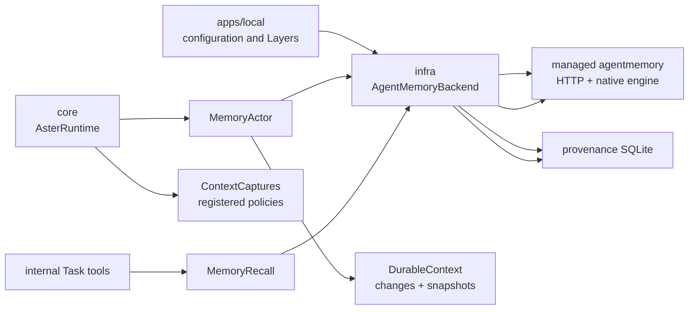

# Memory design

This document describes the memory system that is currently implemented in Aster. It covers the domain contract in `packages/core`, the managed `agentmemory` adapter in `packages/infra`, runtime ownership, source capture policies, recall, persistence and the known gaps. The design was reviewed against the code and tests on 2026-10-11.

## Purpose and boundary

Memory is a backend-independent capability for retaining evidence and explicit durable facts that can be recalled by later Agent Tasks. Core owns capture/write admission, the durable handoff, deduplication, retry and recovery. Infra owns the concrete `agentmemory` process, HTTP protocol, provenance database and native resource lifecycle.

Memory is deliberately separate from the other durable stores:

| Data                                     | Authoritative owner                | Memory relationship                                       |
| ---------------------------------------- | ---------------------------------- | --------------------------------------------------------- |
| Goal state and summary                   | Goal Actor / DurableContext        | Not automatically copied into memory                      |
| Goal and Task conversation bodies        | Pi durable conversations           | Read by capture policies; not a memory store              |
| Context state and source events          | DurableContext                     | Supplies public snapshots to capture policies             |
| Task admission and result                | AgentConversations plus Task state | Task capture can turn selected evidence into observations |
| Search index and compressed observations | Managed agentmemory                | Memory's backend-owned data                               |
| Source observation mapping               | Infra provenance SQLite            | Maps memory IDs back to Context paths                     |

The public memory Context at `/memory` exposes only backend metadata. Its pending queue and captured-session ledger are persisted in the Context state but excluded from the serialized public text.

## Ownership and runtime composition

The local application supplies `AgentMemoryBackend.layer` to `AsterRuntime.layer`. Runtime then constructs the core services and starts the Memory Actor. No application code assembles MemoryActor internals.

The main services are:

- `MemoryBackend` (`packages/core/src/memory/contracts.ts`) exposes backend metadata, `capture`, explicit `save`, `recall` and `drain`.
- `ContextCaptures` (`packages/core/src/memory/capture.ts`) holds the registered selection policies. A policy matches a public Context path, chooses a stable session identity and returns a lazy evidence read.
- `MemoryActor` (`packages/core/src/memory/actor.ts`) owns capture admission, the durable pending queue, in-flight scheduling and retry state.
- `MemoryRecall` (`packages/core/src/memory/recall.ts`) gives read operations a runtime scope and four concurrent slots, independently of capture admission.
- `AgentMemoryBackend` (`packages/infra/src/memory/layer.ts`) resolves settings, starts the daemon, creates the HTTP client and provenance store, and joins admitted work during shutdown.

## Write path

### 1. Startup and policy registration

`AsterRuntime` acquires the backend, registers `taskCapture`, and activates integrations. The Lark installation registers policies for exactly `/lark` and, when enabled, `/lark/mail`.

The current policy matrix is:

| Policy               | Matching paths    | Evidence captured                                                                                  |
| -------------------- | ----------------- | -------------------------------------------------------------------------------------------------- |
| Lark profile         | `/lark`           | Non-empty account profile text                                                                     |
| Lark mailbox profile | `/lark/mail`      | Non-empty mailbox profile text                                                                     |
| Task                 | `/tasks/<sha256>` | Frozen admission evidence when present, and the `task.result` referenced by the completed snapshot |

There is no generic policy for every Context, no policy for `/lark/im` or individual email Contexts, and no policy for Goal Contexts. Explicit `memory_save` writes do not depend on these source policies.

### 2. Detecting a candidate

MemoryActor subscribes to `DurableContext` publications and also scans `registry.snapshot()` every 30 seconds. The periodic scan is the recovery path for Contexts that existed before the Actor started.

For each public `ContextText` record, the Actor:

1. selects the first matching `CapturePolicy`;
2. checks the durable `captured` and `pending` session IDs;
3. evaluates the policy's lazy `records` Effect outside the mailbox;
4. sends a typed `Capture` command back to its own mailbox.

An empty policy result is treated as “do not capture”. The current Actor also puts that session ID into an in-memory `ignored` set.

### 3. Durable admission

The `Capture` handler first appends `{ sessionId, records }` to `/memory` state. Only after that persistence succeeds does it acknowledge the source handoff. This preserves the accepted-state-before-acknowledgement contract.

The Actor dispatches at most two sessions concurrently. Backend success removes the entry from `pending` and appends the session ID to `captured`. A typed backend failure leaves `pending` intact; a scheduled retry runs after 30 seconds. A backend defect reaches Actor supervision and the pending state is replayed after recovery.

### 4. Infra submission

`packages/infra/src/memory/capture.ts` owns one admitted worker per session ID:

1. `POST /agentmemory/session/start` creates the upstream session.
2. Each selected record becomes a `POST /agentmemory/observe` request with the Context path and serialized public record.
3. The adapter inserts `(sessionId, observationId, sourcePath)` into provenance SQLite.
4. It polls `/agentmemory/observations?sessionId=...` until all submitted observation IDs have a title or the processing timeout expires.
5. It calls `POST /agentmemory/session/end`.

The capture worker is scoped to the backend. Interrupting the caller does not cancel already admitted work. Shutdown closes new admission, drains accepted workers, then releases the daemon and provenance resources.

### 5. Task result capture

The current Task schema stores internal research input under `admission.task.input` and execution output under `task.result`. The capture policy reads the result entry referenced by the public Context's `outcomeEntryId` and emits a second `ContextText` record whose text is the result text. This fixed two contract mismatches: the policy only checked the older optional `admission.evidence` field, and it previously selected the last result even when the Context snapshot referred to an earlier round.

The regression is covered by `apps/local/test/processing.test.ts`.

### 6. Explicit `memory_save`

The Goal and internal Task tool catalogues expose `memory_save`. The tool creates a request identity from the current invocation, addresses the Memory Actor, and receives an accepted receipt only after the write request is persisted in the `/memory` Context. The Actor then sends the normalized `{ content, type, concepts, files }` to `POST /agentmemory/remember`.

The upstream endpoint has no idempotency key. A successful backend response records the returned memory ID. A known protocol/business failure is retryable; an interrupted or transport-unknown outcome is recorded as `uncertain` and is not automatically resubmitted, avoiding duplicate memories. The accepted receipt therefore means durable admission, not immediate search visibility.

## Read path

### Runtime and Agent Tasks

`MemoryRecall` wraps the backend's `search` and `expand` operations in scoped fibers with four permits. Interruption releases the permit and interrupts the local wait.

Memory retrieval tools are registered only for internal Tasks:

- `memory_search({ query })` calls the backend smart-search endpoint and returns compact candidates.
- `memory_expand({ items })` requests selected observations, caps the upstream batch at 20, and resolves selected consolidated-memory IDs through the memories endpoint when needed.
- `memory_save({ content, type, concepts, files })` is available to the Goal and internal Tasks and durably admits an explicit fact, preference, decision or finding.

The main Goal Agent can save an explicit durable fact directly. Retrieval remains scoped to internal Tasks, preserving the boundary between Goal coordination and source evidence access.

### Backend protocol and provenance

`packages/infra/src/memory/client.ts` validates every upstream response with Effect Schemas. Search returns compact results and attaches `sourcePaths` using provenance. Expansion returns full observation details and the same provenance fields.

The CLI uses `openMemoryReader` or `configuredMemoryReader` to read a connection file and reuse the same client/provenance implementation. The connection file is published only while the managed backend is running and is removed during release; the underlying memory data remains on disk.

## Configuration and storage

`MemorySettings` resolves `contexts./memory` through the captured `ConfigProvider`. Defaults are:

- data directory: `<durable-root>/memory`;
- REST port: `3111`;
- retrieval: BM25 unless embeddings are configured;
- automatic compression: enabled when an LLM is configured;
- credentials: resolved from the captured environment and retained as `Redacted` until process startup.

The managed adapter writes these artifacts:

- `connection.json`: temporary local connection metadata and secret;
- `state_store.db/`: agentmemory observations, indexes, summaries and native state;
- `stream_store/`: agentmemory live streams;
- `signals-sources.sqlite`: Aster's session/observation-to-Context provenance;
- `iii-config.yaml` and native control files: daemon-owned runtime configuration.

The `/memory` Context persists the Aster-side `pending` and `captured` ledgers. Its public serializer intentionally emits only `status`, `retrieval` and optional LLM metadata.

## Failure, retry and shutdown behavior

Expected backend errors use `MemoryCaptureError` or `MemoryRecallError`; defects remain defects and reach supervision. A source handoff is considered accepted once the `/memory` pending entry commits, not when the external daemon finishes indexing.

On normal shutdown, runtime stops source integrations and the Memory Actor before draining the backend. The backend then closes capture admission, waits for admitted workers, stops the daemon and closes provenance. An interrupted local wait does not prove the external observation was cancelled, so the adapter retains admitted work for drain.

## Findings and open problems

### Resolved — No explicit durable memory-write API

The typed `MemoryBackend.save` contract, Memory Actor durable write queue and `memory_save` tools now cover explicit facts, preferences, decisions and findings. The tool acknowledges durable admission; backend completion remains observable in the private Memory state.

### P1 — Automatic capture coverage is narrower than the configured Memory description

The configured description says Memory retains facts, preferences, decisions and findings, but automatic capture currently covers only two profile Contexts and selected Task records. Lark IM summaries, individual email content, Goal summaries, Signal occurrences and external execution feedback are excluded unless they are carried into a captured Task result.

This may be an intentional privacy boundary, but it is not obvious from the public configuration or Agent behavior. Maintain a policy matrix in product documentation and decide explicitly which source classes are eligible. If IM/mail evidence should be searchable later, add dedicated policies with source-specific privacy filtering and stable identities.

### P2 — “No records” can permanently suppress a capture

When a policy's lazy read returns `undefined`, `MemoryActor` adds the session ID to an in-memory `ignored` set. A transient Pi read race or temporary storage failure can therefore suppress a capture for the rest of that Actor incarnation if the policy produces the same session ID later. The current Task policy usually changes its hash when the Task snapshot changes, but the `CapturePolicy` contract does not guarantee that behavior.

Distinguish deterministic “not eligible” from temporary “evidence unavailable”. Only the former should be ignored. The latter should remain pending or retry with a bounded schedule.

### P2 — The durable captured ledger is unbounded

Every unique session ID is appended to the `/memory` `captured` array. Task session IDs include a hash of the public snapshot, so follow-ups and state changes can grow this array indefinitely. There is no compaction, retention policy or backend reconciliation for old IDs.

Use a bounded durable receipt/index, or compact completed capture IDs once the upstream backend has an idempotent identity and a retention policy. Keep enough receipt information to reject duplicates after restart.

### P2 — Explicit saves still cannot reconcile an unknown upstream outcome

`memory_save` is durably marked `uncertain` when the `/remember` result is unknown. Because the upstream `/remember` endpoint has no idempotency key, Aster cannot safely resubmit it or prove whether a memory was created after a transport interruption. A future operator-facing reconciliation command is still needed.

Automatic observation capture now accepts the upstream `{ deduplicated: true, sessionId }` receipt instead of treating it as a malformed observation. The remaining limitation is that a deduplicated response carries no observation ID, so provenance can only be preserved when the original mapping was already committed.

### P3 — Capture visibility is intentionally delayed

New Contexts can wait for the 30-second snapshot scan, and agentmemory processing is polled in 100 ms intervals up to 120 seconds. Search can therefore return no result immediately after a successful source change even though the source state is durable.

Expose capture status in diagnostics or document the eventual-consistency window. Do not treat a successful `Capture` acknowledgement as proof that recall is immediately available.

### P3 — Read access is scoped to internal Tasks

The main Goal cannot search Memory directly and must admit a Task. This is a coherent ownership boundary, but it adds latency for simple recall and means a Goal may answer from its own Pi conversation without consulting Memory. Keep this boundary only if the product intentionally prioritizes capability isolation over direct recall ergonomics.

## Recommended next steps

1. Decide whether Memory is an evidence index or a fact/decision store. The current code implements the former while the configuration and integration notes describe both.
2. If fact/decision storage is required, add `MemoryWrite`/`memory_save` as a typed, durable core capability and route it through the Memory Actor or an equivalent durable writer.
3. Publish the source capture policy matrix and privacy rules, especially for Lark IM, mail, Goals and Task results.
4. Replace permanent `ignored` suppression with typed eligibility outcomes and retryable evidence acquisition.
5. Add receipt compaction and explicit observation idempotency tests before increasing automatic capture coverage.

## Validation references

The current implementation is exercised by:

- `packages/core/test/memory.test.ts`: admission ordering, deduplication, retry, recovery, privacy and Actor lifecycle;
- `packages/infra/test/memory-capture.test.ts`: scoped capture workers, interruption, drain and defects;
- `packages/infra/test/memory-protocol.test.ts` and `memory-recall.test.ts`: protocol decoding and recall behavior;
- `apps/local/test/processing.test.ts`: Context policy selection, Lark profile capture and completed internal Task result capture;
- `apps/local/test/memory-cli.test.ts`: compact search and selected expansion.

The test suite uses fake transports and temporary stores. It does not prove that a live external LLM or a live daemon will produce a particular compression or semantic extraction result.
